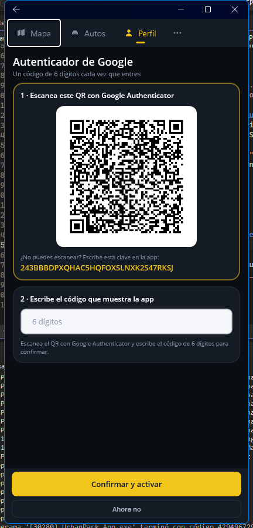
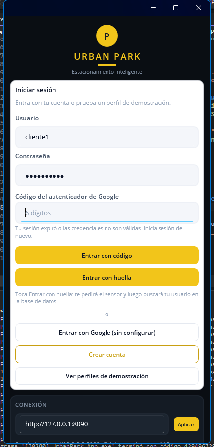
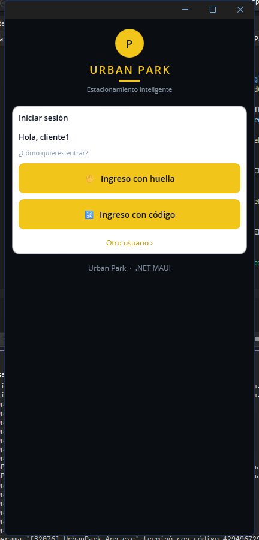
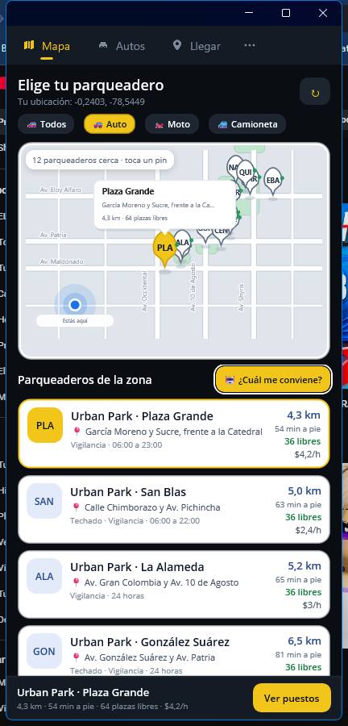
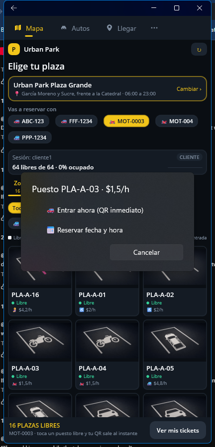
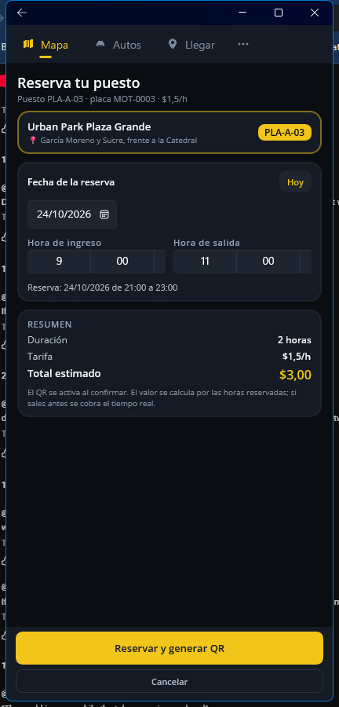
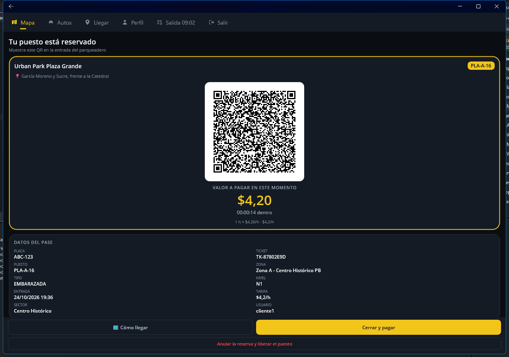
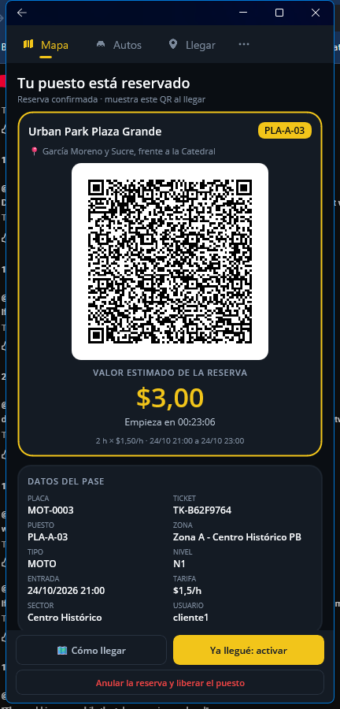

# Urban Park — Versión móvil (.NET MAUI + MySQL + IA DeepSeek)

Aplicación **móvil** que replica el sistema de estacionamiento **Urban Park**. El proyecto original era
HTML + microservicios Java (Spring Boot) + Keycloak + PostgreSQL + Ollama; esta versión lo lleva a
**celular** con **.NET MAUI (C#)**, una **API REST en ASP.NET Core**, base de datos **MySQL**,
autenticación con **usuario/contraseña + Google Sign-In** e IA con la **API de DeepSeek**.

Flujo principal: **el mapa con los 12 parqueaderos** → la **IA recomienda** cuál conviene →
el cliente **elige el puesto** y decide cómo entrar: **«Entrar ahora»** (acceso inmediato) o
**«Reservar»** con **fecha, hora de ingreso y hora de salida**. En los dos casos se abre un
**QR** con los datos del puesto y el **valor a pagar** (el de este momento o el estimado de la reserva).

---

## 1. Qué contiene

```
Parqueadero/
├── UrbanPark.slnx                  Solución (Visual Studio / dotnet)
├── UrbanPark.App/                  Aplicación móvil .NET MAUI (C#)
│   ├── App.xaml(.cs)               Arranque: abre el login
│   ├── MauiProgram.cs              Configuración de MAUI
│   ├── Modelos/Modelos.cs          DTOs del cliente (espejo del contrato del API)
│   ├── Servicios/
│   │   ├── ApiCliente.cs           Cliente HTTP: token, refresco automático y traducción de errores
│   │   ├── Sesion.cs               Sesión cifrada (SecureStorage) y lectura del JWT
│   │   ├── Ubicacion.cs            GPS del celular (o centro de Quito si no hay permiso)
│   │   ├── GoogleAuthServicio.cs   Google Sign-In con WebAuthenticator
│   │   └── Ui.cs                   Alertas y formateo (moneda, fechas, placa, cobro)
│   ├── Views/                      Todas las pantallas (vSedes, vPlazas, vQrPuesto, ...)
│   │   ├── MapaSedes.cs            Mapa dibujado (calles, manzanas, parques y pines)
│   │   ├── vSedes.xaml(.cs)        Mapa con los 12 parqueaderos + recomendación de la IA
│   │   ├── vPlazas.xaml(.cs)       Puestos del parqueadero elegido
│   │   └── vQrPuesto.xaml(.cs)     QR del puesto con el valor a pagar en ese momento
│   └── Platforms/                  Android, iOS, MacCatalyst, Windows
├── UrbanPark.Api/                  API REST (ASP.NET Core, .NET 10)
│   ├── Program.cs                  Arranque, JWT, Swagger, CORS e inicialización de MySQL
│   ├── Data/                       Conexión MySQL + creación de esquema y datos semilla
│   ├── Modelos/                    Entidades, DTOs y reglas de negocio (placa, cobro, roles)
│   ├── Repositorios/               SQL explícito (sin ORM): sedes, espacios, usuarios, tickets
│   ├── Servicios/                  Seguridad, DeepSeek, Circuit Breaker, tickets, sedes, pases
│   └── Controladores/              Auth, Perfil, AdminUsuarios, Sedes, Espacios, Estacionar, ...
├── database/urbanpark_mysql.sql    Script MySQL completo (esquema + datos semilla)
└── docs/                           Guía de ejecución y arquitectura
```

---

## 2. Arranque rápido

```bash
# 1) Base de datos (o deja que la API la cree sola al arrancar)
mysql -u root -p < database/urbanpark_mysql.sql

# 2) API  ->  http://localhost:8090   (Swagger en /swagger)
cd UrbanPark.Api
dotnet run

# 3) App móvil (Android)
cd ../UrbanPark.App
dotnet build -f net10.0-android -t:Run      # con emulador encendido
# o en Windows, para probar rápido:
dotnet build -f net10.0-windows10.0.19041.0 -t:Run
```

Antes de arrancar la API, edita `UrbanPark.Api/appsettings.json`:

| Clave | Qué poner |
|---|---|
| `ConnectionStrings:UrbanPark` | Tu usuario y contraseña de MySQL |
| `Jwt:Key` | Una clave larga y secreta (mínimo 32 caracteres) |
| `DeepSeek:ApiKey` | Tu API key de DeepSeek (opcional: sin ella funciona el respaldo heurístico) |
| `Google:ClientId` | Tu Client ID de Google (opcional: sin él se entra con usuario/contraseña) |

Detalle paso a paso en **[docs/GUIA_EJECUCION.md](docs/GUIA_EJECUCION.md)**.

> **Nota:** compila siempre indicando el framework (`-f net10.0-android` o `-f net10.0-windows10.0.19041.0`).
> `dotnet build UrbanPark.slnx` a secas intentaría también iOS y MacCatalyst, que necesitan un Mac con Xcode.

### Pruebas (todo verificado, 281 comprobaciones)

```bash
# 1) Reglas de negocio (no necesitan MySQL)          -> 75 comprobaciones
dotnet run --project tests/UrbanPark.Pruebas

# 2) Integración real contra MySQL                    -> 131 comprobaciones
#    (requiere MySQL encendido)
dotnet run --project tests/UrbanPark.Integracion

# 3) Recorrido HTTP completo de la API                -> 86 comprobaciones
#    (requiere la API en marcha)
powershell -ExecutionPolicy Bypass -File tests\prueba_http.ps1
```

Cubren la fórmula de cobro, la validación de placas, la jerarquía de roles, los vectores RFC 6238 del autenticador de Google, los hashes PBKDF2 de los
usuarios demo del script SQL, el Circuit Breaker + Reintentos, el motor de IA con su respaldo heurístico,
los 12 parqueaderos (direcciones, distancias y recomendación), el pase del puesto con su QR, y el
recorrido completo por HTTP (login, permisos por rol, tickets, cobro, reporte y administración).

Estado actual: **75/75 + 131/131 + 86/86 — todo correcto**. Detalle en
[docs/GUIA_EJECUCION.md](docs/GUIA_EJECUCION.md#9-verificación-realizada-sobre-este-proyecto).

---

## 3. Usuarios demo

| Usuario | Contraseña | Rol | Qué ve en la app |
|---|---|---|---|
| `cliente1` | `cliente123` | CLIENTE | Mapa · Mis vehículos · Mis tickets · QR del puesto · IA · Mi perfil · JWT |
| `cliente2` | `cliente123` | CLIENTE | igual |
| `cliente3` | `cliente123` | CLIENTE | igual |
| `operador1` | `operador123` | OPERADOR | Mapa · Plazas · Vehículos · Tickets · Mi perfil · JWT (sin IA) |
| `admin1` | `admin123` | ADMIN + OPERADOR | **Todas** + Reporte IA + Resilience + Usuarios |

La regla de roles es la misma del sistema original: **rol efectivo único y jerárquico
(ADMIN > OPERADOR > CLIENTE)**, definida en `TABS_POR_ROL`.

---

## 4. Las 12 pantallas

| Pantalla | Roles | Qué hace |
|---|---|---|
| **Iniciar sesión** | público | Login local, **huella o código de Google Authenticator**, registro público y panel de perfiles demo (la dirección del API se configura en *Mi perfil*) |
| **Mapa de parqueaderos** | todos | Los **12 parqueaderos** en el mapa (calles, manzanas y parques de Quito), con distancia a pie, plazas libres y precio. Es la **primera pantalla** al entrar |
| **Recomendación de la IA** | CLIENTE, ADMIN | «¿Cuál me conviene?»: la IA elige el parqueadero por distancia, disponibilidad, precio y servicios, y explica por qué |
| **Puestos del parqueadero** | todos | Zonas y cuadrícula del parqueadero elegido. Al tocar un puesto libre se eligen las **dos formas de entrar**: «Entrar ahora» o «Reservar» |
| **Reservar fecha y hora** | todos | Fecha, **hora de ingreso** y **hora de salida**; muestra la duración y el total estimado antes de confirmar |
| **QR del puesto** | todos | Se abre **al confirmar** (acceso inmediato o reserva): QR con parqueadero, dirección, puesto, placa y el **valor a pagar**. En una reserva muestra la franja y el importe estimado, con «Ya llegué: activar» y «Anular» |
| **Plazas y ocupación** | todos | Indicadores, cuadrícula de plazas, liberar plaza (personal), aviso «estás estacionado en…» |
| **Vehículos / Mis vehículos** | todos | Alta de vehículo y listado (el CLIENTE solo ve los suyos) |
| **Tickets entrada / salida** | todos | Apertura, cierre con cobro, filtros, resumen de consumo y sincronizar plazas |
| **Asignación con DeepSeek** | CLIENTE, ADMIN | Recomendar plaza, asignar plaza (abre ticket) y **chat con la IA** |
| **Reporte IA** | ADMIN | Reporte por rango de fechas con narrativa de DeepSeek y 6 secciones |
| **Resilience** | ADMIN | Circuit Breaker + Retry + fallback, detener/iniciar el servicio de espacios |
| **Usuarios** | ADMIN | Crear, editar, cambiar contraseña y activar/desactivar usuarios |
| **Mi perfil** | todos | Datos personales, contraseña, huella y **autenticador de Google** (activar/desactivar) |
| **Sesión y JWT** | todos | Claims del token y el JWT completo |

---

## 5. Reglas de negocio replicadas

- **Cobro**: `minutos = max(1, floor(diferencia))` → `horas = ceil(minutos/60)` → `monto = round(horas × tarifa, 2)`.
  Mínimo una hora, sin topes. La tarifa se copia de la plaza al abrir el ticket.
- **Placa**: se normaliza (trim, mayúsculas, sin espacios) y debe cumplir `^[A-Z0-9]{2,8}(-?[A-Z0-9]{1,4})?$` con 4–12 caracteres.
- **Un solo ticket ABIERTO por placa** y **uno por plaza**.
- **Cobrar nunca depende del servicio de espacios**: si está caído, el ticket se cierra y queda
  `liberacionPendiente = true`, que la app marca como «Plaza pendiente sync».
- **12 parqueaderos (sedes)** en direcciones distintas de Quito, con sus coordenadas para el mapa y la
  distancia: 4 zonas de 16 plazas cada uno (**768 plazas**), tarifas por sede de 1.5 a 5.0.
- **Tipos de plaza**: AUTO, MOTO, CAMIONETA, DISCAPACIDAD y EMBARAZADA. Los puestos preferenciales solo
  se reservan con el perfil que corresponde (discapacidad / embarazada), como en el sistema original.
- **El valor del QR** se calcula con la misma fórmula en el API y en la app, así el QR se sigue viendo
  aunque el equipo se quede sin conexión.
- **Dos modos de entrada**: `AHORA` (el ticket nace ABIERTO y el valor corre desde ese instante) y
  `RESERVA` (el ticket nace RESERVADO con fecha, hora de ingreso y hora de salida; el puesto queda
  guardado y el QR muestra el importe estimado de la franja). Al llegar, «Ya llegué: activar» lo
  convierte en una estancia normal. Una reserva se puede anular sin costo.

---

## 6. Los 12 parqueaderos

| Código | Parqueadero | Dirección | Tarifa/h |
|---|---|---|---|
| CEN | Urban Park Centro Histórico | Av. 10 de Agosto N21-56 y Av. Roca | 3.50 |
| PLA | Urban Park Plaza Grande | García Moreno y Sucre, frente a la Catedral | 4.20 |
| ALA | Urban Park La Alameda | Av. Gran Colombia y Av. 10 de Agosto | 3.00 |
| SAN | Urban Park San Blas | Calle Chimborazo y Av. Pichincha | 2.40 |
| GON | Urban Park González Suárez | Av. González Suárez y Av. Patria | 3.80 |
| COL | Urban Park Colón | Av. Colón y Av. 6 de Diciembre | 3.20 |
| FOC | Urban Park La Foch | Av. Reina Victoria N24-56 y La Pinta | 2.80 |
| MAR | Urban Park Mariscal | Av. Amazonas N30-12 y Av. Eloy Alfaro | 2.60 |
| CAR | Urban Park La Carolina | Av. Naciones Unidas y Núñez de Vela | 3.60 |
| QUI | Urban Park Quicentro | Av. Naciones Unidas y Av. 6 de Diciembre | 4.20 |
| NAC | Urban Park Naciones Unidas | Av. Naciones Unidas y Av. Japón | 3.40 |
| EBA | Urban Park El Batán | Av. Eloy Alfaro y Av. Naciones Unidas | 2.90 |

> El mapa se dibuja con `Microsoft.Maui.Graphics`: no necesita clave de Google Maps ni internet.
> Las avenidas y los parques están en su latitud/longitud real, y los pines son tocables.

---

## 7. Autenticador de Google (segundo factor)

Además de la contraseña, cada cuenta puede activar el **autenticador de Google** (TOTP, RFC 6238).
No hace falta ninguna cuenta de Google Cloud: el secreto se guarda en `usuarios.totp_secret`.

1. **Mi perfil → Autenticador de Google → Activar autenticador**.
2. La app muestra un **QR** (y la clave en texto) → escanéalo con **Google Authenticator**.
3. Escribe el código de 6 dígitos para confirmar. Desde ese momento, al entrar se pide
   usuario + contraseña + **código de 6 dígitos**.
4. Se puede desactivar desde el mismo sitio (pidiendo un código válido).

| QR para Google Authenticator | El login pide el código |
|---|---|
|  |  |

### Las formas de entrar

| Situación | Qué pide la app | Cómo funciona |
|---|---|---|
| Primera vez | Usuario + contraseña | Login normal contra el API |
| La cuenta usa autenticador | Usuario + contraseña + **código de 6 dígitos** | Segundo factor TOTP |
| Equipo ya vinculado | **Solo el código** (el usuario ya se conoce) | El API vincula el equipo al primer login con código; la app muestra «Hola, cliente1» y el campo del código |
| Sin internet | Usuario + contraseña | Se comprueba contra el hash PBKDF2 guardado en el equipo y se abre con la sesión y los datos ya descargados |

**Cuando la cuenta ya usa el autenticador, la app muestra solo dos opciones:**

| Opción | Qué hace |
|---|---|
| **🖐 Ingreso con huella** | Confirma el dueño con la huella/rostro del teléfono y abre la sesión sin pedir el código (el equipo ya está vinculado) |
| **🔢 Ingreso con código** | Muestra el campo de 6 dígitos: se escribe, o se copia en Google Authenticator y al volver se pega solo y entra |

Debajo de las dos opciones hay un enlace pequeño, **«Otro usuario ›»**, para entrar con otra cuenta (muestra el
login completo con usuario y contraseña, sin el usuario recordado). Si el equipo deja de estar vinculado, la app
vuelve sola a ese login completo.


La dirección del API ya no está en el login: se cambia en **Mi perfil → Conexión con el API** (para el emulador, el celular en la misma WiFi o un servidor propio).

### Desvincular a todos los usuarios (script)

`database\desvincular_usuarios.bat` deja a las cuentas otra vez en usuario + contraseña: borra el secreto del
autenticador de Google y los equipos vinculados.

```bat
cd database
desvincular_usuarios.bat              :: pregunta y desvincula a todos
desvincular_usuarios.bat cliente1     :: solo ese usuario
desvincular_usuarios.bat /y           :: todos, sin preguntar
```

Muestra una tabla de **antes / después** y cuántos autenticadores y equipos se quitaron. Si el contenedor de
MySQL no está corriendo (o faltan los datos de conexión), avisa y no cambia nada.

Si alguien pierde el celular, un ADMIN puede quitarle el autenticador con `PUT /api/admin/users/{id}/totp`
(eso además borra sus equipos vinculados).
Endpoints: `GET /api/auth/totp/estado`, `POST /api/auth/totp/preparar`,
`POST /api/auth/totp/confirmar` y `POST /api/auth/totp/desactivar`. Si la cuenta lo tiene activo y
el login llega sin código, el API responde `401` con `error = "TOTP_REQUIRED"` y la app muestra el
campo del código automáticamente.

---

## 8. Subir el proyecto a GitHub

`subir_a_github.bat` (en la raíz) crea el repositorio si no existe y sube todo, sin las carpetas
`bin`, `obj` ni `.vs` (eso lo controla `.gitignore`).

```bat
subir_a_github.bat
```

Antes de ejecutarlo, ajusta las tres primeras líneas del archivo:

| Variable | Para qué sirve |
|---|---|
| `GITHUB_USUARIO` | tu usuario de GitHub |
| `REPO` | nombre del repositorio (por defecto `UrbanPark`) |
| `VISIBILIDAD` | `--public` (por defecto) o `--private` |

Hace: `git init` si falta, configura nombre/correo, `git add -A`, el commit, crea el repositorio con
GitHub CLI (`gh`) si está autenticado y hace `git push`. Si `gh` no está, usa `git` normal y explica cómo
autenticarse con un token (PAT).

Repositorio de este proyecto: <https://github.com/mgbunay2015/UrbanPark> (público).

---

## 9. Documentación
- **[docs/GUIA_EJECUCION.md](docs/GUIA_EJECUCION.md)** — cómo ejecutarlo, configurar DeepSeek y Google, y probarlo desde el celular.
- **[docs/ARQUITECTURA.md](docs/ARQUITECTURA.md)** — equivalencia con el proyecto original, tabla de endpoints y esquema MySQL.

### Capturas

| Mapa de parqueaderos | Dos formas de entrar | Reservar fecha y hora |
|---|---|---|
|  |  |  |

| QR del puesto (acceso inmediato) | QR de la reserva |
|---|---|
|  |  |
