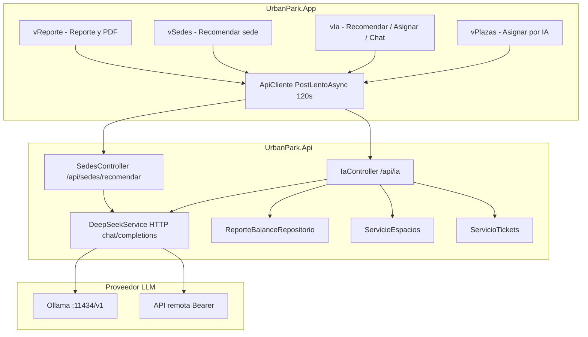
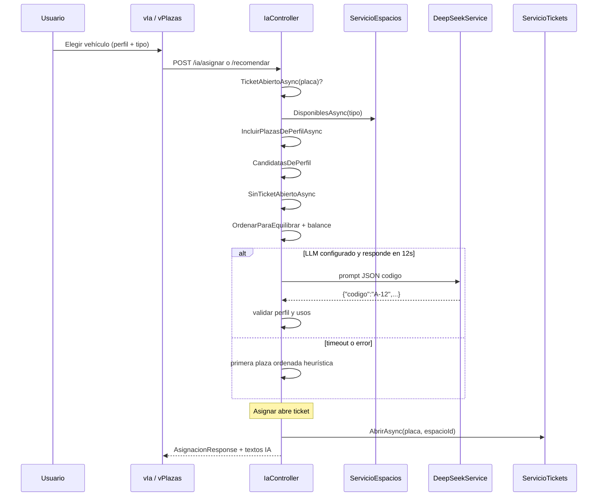

# Manual de IA, asignación de plazas y reportes — Urban Park

Documentación orientada a **entender qué hace la IA**, **qué archivos intervienen**, **cómo se asignan plazas en los parqueaderos** y **cómo se generan los textos y exportaciones del reporte administrador**.

---

## 1. Resumen ejecutivo

Urban Park combina tres capas:

| Capa | Qué decide | Quién redacta el texto |
|------|------------|----------------------|
| **Reglas de negocio (C#)** | Perfil del conductor, tipo de vehículo, plazas libres, tickets abiertos, equilibrio por uso histórico | Mensajes fijos (`MotivoDePerfil`, hallazgos del reporte) |
| **Heurística local** | Orden de plazas cuando la IA no responde a tiempo o no está configurada | `heuristica-local` en `ProveedorIa` |
| **LLM (OpenAI-compatible)** | Elige un `codigo` de plaza entre candidatos ya filtrados; narra sede, reporte y chat | Ollama local (`llama3.2:3b` por defecto) o API remota con clave (Grok/DeepSeek, etc.) |

**Principio clave:** la IA **nunca** elige plazas fuera del perfil legal. El API filtra candidatas, ordena por equilibrio (`reporte_balance`) y solo entonces pide al modelo un JSON `{"codigo","motivo"}`. Si el modelo falla, se usa la primera plaza del orden heurístico.

---

## 2. Arquitectura (flujo de datos)



### 2.1 Bucle “reporte → asignación equilibrada”

1. El **administrador** genera `POST /api/ia/reporte-tickets` **sin filtro de sedes** → el API guarda en MySQL tabla `reporte_balance` (fila `id=1`) los usos por **zona** y por **código de plaza** del periodo.
2. En `POST /api/ia/recomendar` y `POST /api/ia/asignar`, `IaController.ElegirPlazaAsync` lee ese balance y ordena candidatas: menos usos históricos primero.
3. El prompt de asignación incluye esos contadores; la IA debe preferir plazas menos usadas **del mismo perfil**.

Si el reporte se pide **solo para una o varias sucursales**, **no** se sobrescribe `reporte_balance` (el equilibrio sigue siendo el último reporte global).

---

## 3. Configuración del motor de IA

### 3.1 Archivo principal

`UrbanPark.Api/appsettings.json` — sección `DeepSeek` (nombre histórico; el código soporta cualquier API compatible con OpenAI):

| Clave | Valor por defecto en repo | Efecto |
|-------|---------------------------|--------|
| `BaseUrl` | `http://127.0.0.1:11434/v1` | Si contiene `11434`, `127.0.0.1` o `localhost` → modo **Ollama** |
| `ApiKey` | `ollama` | En Ollama se envía Bearer; en remoto debe ser clave real (no `TU_...`) |
| `Model` | `llama3.2:3b` | Modelo en `chat/completions` |
| `Temperature` | `0.3` | Menor variación en JSON de asignación |
| `TimeoutSeconds` | `180` | HttpClient de `DeepSeekService` |

Copia local opcional: `appsettings.Local.json` (no versionado).

### 3.2 Registro en el arranque

`UrbanPark.Api/Program.cs`:

- `AddHttpClient<DeepSeekService>(timeout 180s)`
- Swagger describe la API como “MySQL + IA DeepSeek”

### 3.3 Cómo sabe el código si está “configurado”

`DeepSeekService.Configurado`:

- **Local (Ollama):** siempre true si la URL es local.
- **Remoto:** requiere `ApiKey` no vacía y distinta de placeholders `TU_*` y `ollama`.

`Nombre` / `Proveedor`: `Ollama` → `ollama/{modelo}`; remoto → `Grok` → `grok/{modelo}`.

### 3.4 Comprobar estado

| Quién | Cómo |
|-------|------|
| HTTP | `GET /api/ia/estado` o alias `GET /api/ia/ollama` |
| App | Pantalla `vIa` → botón estado; `vReporte` antes de generar |
| Salud anónima | `GET /api/ia/salud` |

El estado hace `GET {BaseUrl}/models` con timeout de 5 s.

---

## 4. Inventario de archivos (mapa completo)

### 4.1 API — núcleo IA y reportes

| Archivo | Responsabilidad |
|---------|-----------------|
| `UrbanPark.Api/Servicios/DeepSeekService.cs` | Cliente HTTP: `GenerarAsync`, `ConversarAsync`, `EstadoAsync`, utilidades `ExtraerObjetoJson`, `LeerTexto` |
| `UrbanPark.Api/Controladores/IaController.cs` | Endpoints IA: recomendar, asignar, reporte-tickets, chat, estado; prompts; perfiles; heurística; timeouts 12s (asignación) y 25s (reporte narrativo) |
| `UrbanPark.Api/Servicios/ServicioSedes.cs` | Recomendación de **sedes** (parqueaderos): puntaje determinista + narración IA opcional |
| `UrbanPark.Api/Controladores/SedesController.cs` | `POST /api/sedes/recomendar` delega en `ServicioSedes` |
| `UrbanPark.Api/Repositorios/ReporteBalanceRepositorio.cs` | Persistencia `reporte_balance` (JSON de usos por zona/plaza) |
| `UrbanPark.Api/Modelos/Dtos.cs` | DTOs `Recomendacion*`, `Asignacion*`, `Reporte*`, `Chat*`, `IaEstado*` |
| `UrbanPark.Api/Data/InicializadorDb.cs` | Crea tabla `reporte_balance` |
| `UrbanPark.Api/Servicios/ServicioEspacios.cs` | Plazas libres, ocupación (usado en prompts y reporte) |
| `UrbanPark.Api/Servicios/ServicioTickets.cs` | Abrir ticket tras asignar IA; reconciliación previa al reporte |
| `UrbanPark.Api/Repositorios/TicketRepositorio.cs` | Tickets del periodo, abiertos por placa |
| `UrbanPark.Api/Repositorios/VehiculoRepositorio.cs` | Perfil `Propietario` para estadísticas “tipo de persona” |

### 4.2 App móvil — pantallas y exportación

| Archivo | Responsabilidad |
|---------|-----------------|
| `UrbanPark.App/Servicios/ApiCliente.cs` | `RecomendarAsync`, `AsignarAsync`, `ReporteAsync`, `ChatAsync`, `EstadoIaAsync`, `RecomendarSedeAsync`; `PostLentoAsync` 120 s; HttpClient global 180 s |
| `UrbanPark.App/Views/vIa.xaml` + `.xaml.cs` | UI asignación IA, recomendar, manual, chat, estado Ollama |
| `UrbanPark.App/Views/vPlazas.xaml.cs` | Botón “Asignar por IA” (recomendar con tope 6 s + fallback local en mapa) |
| `UrbanPark.App/Views/vSedes.xaml.cs` | Panel recomendación de **sede** (`OnIaClicked` → `RecomendarSedeAsync`) |
| `UrbanPark.App/Views/vReporte.xaml` + `.xaml.cs` | Generar reporte, redactar con IA aparte, PDF, CSV, Excel |
| `UrbanPark.App/Servicios/ReportePdf.cs` | PDF QuestPDF: una página por parqueadero, incluye `ResumenIa` y hallazgos |
| `UrbanPark.App/Servicios/ExcelDecisiones.cs` | Excel con gráficas + contexto del reporte IA |
| `UrbanPark.App/Modelos/Dtos.cs` (o equivalentes) | Tipos cliente `ReporteDto`, `RecomendacionDto`, etc. |
| `UrbanPark.App/Views/vPrincipal.cs` | Pestaña **Reportería** → `vReporte` (solo admin) |

### 4.3 Documentación y PDF

| Archivo | Uso |
|---------|-----|
| `docs/MANUAL_IA_Y_REPORTES.md` | Este documento |
| `docs/manual-pdf.css` | Estilos impresión |
| `tools/ExportarManual/Program.cs` | Markdown → HTML → PDF (Edge headless) |
| `docs/generar-manual-ia-pdf.ps1` | Script para generar `MANUAL_IA_Y_REPORTES.pdf` |

---

## 5. API REST — rutas exactas (IA y reportes)

Todas las rutas de Urban Park son **rutas absolutas desde el host del API** (path que concatena `ApiCliente.BaseUrl` + la tabla siguiente).

### 5.0 URLs base del proyecto

| Uso | URL exacta (ejemplos) | Archivo / nota |
|-----|------------------------|----------------|
| **API Urban Park** | `http://localhost:8090` | `UrbanPark.Api/appsettings.json` → `"Urls": "http://0.0.0.0:8090;..."` |
| **API en red / app configurada** | `http://10.2.9.187:8090/` | `UrbanPark.App/Servicios/ApiCliente.cs` → `UrlPorDefecto()` actual |
| **Emulador Android → PC** | `http://10.0.2.2:8090` | Comentario en `ApiCliente` (puerto 8090) |
| **Swagger UI** | `http://localhost:8090/swagger` | `UrbanPark.Api/Program.cs` |
| **OpenAPI JSON** | `http://localhost:8090/swagger/v1/swagger.json` | Misma |
| **LLM (Ollama)** | `http://127.0.0.1:11434/v1/chat/completions` | `DeepSeek:BaseUrl` + sufijo |
| **Modelos Ollama** | `http://127.0.0.1:11434/v1/models` | `DeepSeekService.EstadoAsync` |

**Cabecera obligatoria** (salvo login y `/api/ia/salud`):

```http
Authorization: Bearer {accessToken}
Content-Type: application/json
```

Token: `POST http://localhost:8090/api/auth/login` → cuerpo `{"username":"...","password":"..."}` → respuesta `accessToken` (camelCase).

---

### 5.1 Urban Park — endpoints IA (`IaController`)

Prefijo del controlador: `[Route("api/ia")]` → archivo `UrbanPark.Api/Controladores/IaController.cs`.

| # | Método | Ruta exacta (path) | URL completa ejemplo | Roles | Descripción |
|---|--------|-------------------|----------------------|-------|-------------|
| 1 | `POST` | `/api/ia/recomendar` | `http://localhost:8090/api/ia/recomendar` | `CLIENTE`, `ADMIN` | Sugiere plaza (no abre ticket) |
| 2 | `POST` | `/api/ia/asignar` | `http://localhost:8090/api/ia/asignar` | `CLIENTE`, `ADMIN` | Elige plaza + abre ticket |
| 3 | `POST` | `/api/ia/reporte-tickets` | `http://localhost:8090/api/ia/reporte-tickets` | `ADMIN` | Reporte + texto IA + balance |
| 4 | `POST` | `/api/ia/chat` | `http://localhost:8090/api/ia/chat` | Cualquier JWT válido | Chat asistente |
| 5 | `GET` | `/api/ia/estado` | `http://localhost:8090/api/ia/estado` | Cualquier JWT válido | Estado Ollama/Grok |
| 6 | `GET` | `/api/ia/ollama` | `http://localhost:8090/api/ia/ollama` | Cualquier JWT válido | **Alias** de `/estado` |
| 7 | `GET` | `/api/ia/salud` | `http://localhost:8090/api/ia/salud` | **Anónimo** (`[AllowAnonymous]`) | Health ms-ia |

**OPERADOR:** los `POST` `/recomendar` y `/asignar` responden **403 Forbidden** (atributo `[Authorize(Roles = "CLIENTE,ADMIN")]`).

**Timeouts en app:** `PostLentoAsync` → **120 s** por llamada (`ApiCliente.cs` líneas 85–86). El servidor cancela la redacción del reporte a **25 s** y la elección de plaza a **12 s** (aunque el HTTP puede seguir hasta que responda el controlador).

---

### 5.2 Urban Park — IA en sedes (parqueadero completo)

Controlador: `UrbanPark.Api/Controladores/SedesController.cs` → `[Route("api/sedes")]`.

| # | Método | Ruta exacta | URL completa ejemplo | Roles | Descripción |
|---|--------|-------------|----------------------|-------|-------------|
| A | `GET` | `/api/sedes?lat={lat}&lng={lng}&tipo={tipo}&preferencia={texto}` | `http://localhost:8090/api/sedes?lat=-0.18&lng=-78.47&tipo=AUTO` | JWT | Catálogo 12 sedes + distancia |
| B | `GET` | `/api/sedes/{id}?lat={lat}&lng={lng}` | `http://localhost:8090/api/sedes/1?lat=-0.18&lng=-78.47` | JWT | Detalle sede + zonas |
| C | `POST` | `/api/sedes/recomendar` | `http://localhost:8090/api/sedes/recomendar` | `CLIENTE`, `ADMIN` | Mejor sede + texto IA |

**Rutas auxiliares** que la IA usa por dentro (no llaman al LLM directamente, pero alimentan asignación y reporte):

| Método | Ruta exacta | Uso en flujo IA |
|--------|-------------|-----------------|
| `GET` | `/api/espacios/disponibles?tipo=AUTO&zona=&sedeId=` | Candidatas libres |
| `GET` | `/api/espacios/ocupacion` o `?sedeId=` | Prompt ocupación por zona |
| `POST` | `/api/tickets/reconciliar-plazas` | Antes del reporte |
| `POST` | `/api/tickets/abrir` | Fallback manual; asignar IA lo llama vía `ServicioTickets` |

---

### 5.3 Pantalla MAUI → ruta exacta (`ApiCliente`)

| Pantalla | Acción usuario | Método C# | **Ruta HTTP exacta** |
|----------|----------------|-----------|----------------------|
| `vIa` | Recomendar plaza | `RecomendarAsync` | `POST /api/ia/recomendar` |
| `vIa` | Asignar con IA | `AsignarAsync` | `POST /api/ia/asignar` |
| `vIa` | Chat | `ChatAsync` | `POST /api/ia/chat` |
| `vIa` | Estado motor | `EstadoIaAsync` | `GET /api/ia/estado` |
| `vPlazas` | Asignar por IA (mapa) | `RecomendarAsync` (tope 6 s) | `POST /api/ia/recomendar` |
| `vSedes` | Recomendar parqueadero | `RecomendarSedeAsync` | `POST /api/sedes/recomendar` |
| `vReporte` | Generar reporte | `ReporteAsync(..., conIa: false)` por defecto en UI; botón IA vuelve a pedir con IA | `POST /api/ia/reporte-tickets` |
| `vReporte` | PDF (una sede por hoja) | `ReporteAsync` por cada `sedeId` | `POST /api/ia/reporte-tickets` (body con `sedes: [id]`) |

---

### 5.4 Ejemplos `curl` (reemplaza `TOKEN`)

**Login (obtener token):**

```bash
curl -s -X POST "http://localhost:8090/api/auth/login" ^
  -H "Content-Type: application/json" ^
  -d "{\"username\":\"admin\",\"password\":\"TU_CLAVE\"}"
```

**Estado IA:**

```bash
curl -s "http://localhost:8090/api/ia/estado" -H "Authorization: Bearer TOKEN"
```

**Recomendar plaza:**

```bash
curl -s -X POST "http://localhost:8090/api/ia/recomendar" ^
  -H "Authorization: Bearer TOKEN" -H "Content-Type: application/json" ^
  -d "{\"tipoVehiculo\":\"AUTO\",\"preferencia\":\"Mujer, marca Kia, tipo AUTO\",\"placa\":\"PBX-1234\"}"
```

**Asignar plaza + ticket:**

```bash
curl -s -X POST "http://localhost:8090/api/ia/asignar" ^
  -H "Authorization: Bearer TOKEN" -H "Content-Type: application/json" ^
  -d "{\"placa\":\"PBX-1234\",\"tipoVehiculo\":\"AUTO\",\"preferencia\":\"Mujer, marca Kia, tipo AUTO\"}"
```

**Reporte administrador (con narración IA):**

```bash
curl -s -X POST "http://localhost:8090/api/ia/reporte-tickets" ^
  -H "Authorization: Bearer TOKEN" -H "Content-Type: application/json" ^
  -d "{\"fechaDesde\":\"2026-11-01\",\"fechaHasta\":\"2026-11-24\",\"sedes\":null,\"sinIa\":false}"
```

**Reporte rápido sin LLM:**

```bash
curl -s -X POST "http://localhost:8090/api/ia/reporte-tickets" ^
  -H "Authorization: Bearer TOKEN" -H "Content-Type: application/json" ^
  -d "{\"fechaDesde\":\"2026-11-24\",\"fechaHasta\":\"2026-11-24\",\"sinIa\":true}"
```

**Chat:**

```bash
curl -s -X POST "http://localhost:8090/api/ia/chat" ^
  -H "Authorization: Bearer TOKEN" -H "Content-Type: application/json" ^
  -d "{\"mensaje\":\"¿Cuántas plazas libres hay en Zona D?\",\"historial\":[]}"
```

**Recomendar sede (mapa Llegar):**

```bash
curl -s -X POST "http://localhost:8090/api/sedes/recomendar" ^
  -H "Authorization: Bearer TOKEN" -H "Content-Type: application/json" ^
  -d "{\"tipoVehiculo\":\"AUTO\",\"latitud\":-0.1807,\"longitud\":-78.4678,\"preferencia\":\"Hombre, tipo AUTO\",\"placa\":\"PBX-1234\"}"
```

**Salud IA (sin token):**

```bash
curl -s "http://localhost:8090/api/ia/salud"
```

---

### 5.5 LLM interno (servidor → Ollama / API remota)

`DeepSeekService` **no** expone rutas en Urban Park; llama al proveedor configurado:

| Operación | Método | Ruta exacta en el proveedor |
|-----------|--------|------------------------------|
| Asignación / reporte / chat | `POST` | `{DeepSeek:BaseUrl}/chat/completions` |
| Comprobar disponibilidad | `GET` | `{DeepSeek:BaseUrl}/models` |

Ejemplo con Ollama por defecto:

- `POST http://127.0.0.1:11434/v1/chat/completions`
- `GET http://127.0.0.1:11434/v1/models`

---

### 5.6 Cuerpos JSON (nombres exactos en wire — camelCase)

**Recomendar plaza** (`RecomendarRequest`):

```json
{
  "tipoVehiculo": "AUTO",
  "preferencia": "Embarazada, marca Toyota, tipo AUTO",
  "placa": "ABC-1234"
}
```

**Asignar** (`AsignarRequest`): mismos campos; `placa` obligatoria.

**Reporte** (`ReporteRequest`):

```json
{
  "fechaDesde": "2026-11-01",
  "fechaHasta": "2026-11-24",
  "sedes": [1, 3],
  "sinIa": false
}
```

- `sedes` vacío o omitido → todas las sucursales en agregados; guarda `reporte_balance` si no hay filtro.
- `sinIa: true` → solo hallazgos + resumen heurístico (inmediato).

### 5.2 Campos de texto que ve el usuario

| Campo en respuesta | Origen |
|--------------------|--------|
| `Motivo` | Plantilla por perfil y plaza, o JSON del LLM |
| `ExplicacionIa` | `ExplicacionEquilibrada` + uso de `reporte_balance` |
| `ProveedorIa` / `Proveedor` | `ollama/llama3.2:3b`, `grok/...` o `heuristica-local` |
| `ResumenIa` (reporte) | Prompt narrativo de 5 bloques o párrafo de respaldo |
| `Hallazgos` | Lista calculada en C# (ocupación, dinero, hora pico, etc.) |
| `Alternativas` | Hasta 3 otras plazas libres del mismo filtro |

---

## 6. Asignación de plazas — algoritmo paso a paso

Implementación: `IaController.Recomendar` y `IaController.Asignar` (misma lógica de elección; asignar añade `ServicioTickets.AbrirAsync` con reintentos en otras candidatas si hay 409).

### 6.1 Secuencia



### 6.2 Cadena de texto “preferencia” (app → API)

En `vIa.PerfilParaIa` y `vPlazas.PerfilParaIa`:

- Campo `VehiculoDto.Propietario` (ej. “Embarazada”, “Hombre”, “Capacidades Especiales”).
- Marca, color, tipo concatenados: *"Embarazada, marca Toyota, color blanco, tipo AUTO"*.

Ese string alimenta `ReglaDe(preferencia)` en el prompt y `PrioridadPerfil` en C#.

### 6.3 Reglas de perfil → plaza (servidor)

Funciones: `PrioridadPerfil`, `CandidatasDePerfil`, `MotivoDePerfil`, `ReglaDe`.

| Perfil (palabras clave en preferencia) | Plaza aceptable | Descuento (regla de negocio) |
|----------------------------------------|-----------------|------------------------------|
| Capacidades / discapacitado / especial | `TipoVehiculo = DISCAPACIDAD` | 50% |
| Tercera edad / anciano / mayor | Zona A, nivel 1, tipo común | 50% |
| Embarazada | `EMBARAZADA` | 25% |
| Estudiante | Zona C | 25% |
| Mujer | Zona D | Sin descuento |
| Hombre | Zona B o C | Sin descuento |
| (otro) | Cualquier libre del tipo de vehículo | Por tarifa |

`CandidatasDePerfil` deja solo plazas con la **mejor** prioridad (menor número). La IA solo ve esa lista.

### 6.4 Orden heurístico (sin LLM o como respaldo)

`OrdenarParaEquilibrar`:

1. `PrioridadPerfil` (perfil)
2. Menos usos en `reporte_balance.Plazas`
3. Menos usos en `reporte_balance.Zonas`
4. Menor `%` ocupación de la zona ahora
5. Menor `TarifaHora`
6. `PreferenciaNivel` (cerca entrada / barato según palabras en preferencia)

### 6.5 Prompt de asignación (resumen)

`ConstruirPromptAsignacion` incluye:

- Tipo vehículo y texto de persona
- `ReglaDe` (una sola regla imperativa)
- Ocupación por zona (`DescripcionZonas`)
- Historial del reporte guardado
- Lista JSON de plazas permitidas (ya ordenadas)
- Instrucción: responder **solo** `{"codigo","motivo"}`

**Validaciones post-LLM:**

- `codigo` debe existir en la lista
- No puede empeorar prioridad de perfil respecto a la mejor heurística
- Si elige plaza más usada que la heurística top con balance cargado → se fuerza la heurística

### 6.6 Diferencias en la app

| Pantalla | Comportamiento |
|----------|----------------|
| **vIa** | Llama `/asignar` o `/recomendar` con timeout cliente 120 s; muestra motivo y explicación completos |
| **vPlazas** | Solo `/recomendar` con **tope 6 s**; si no responde, `ElegirMejorPlazaLocal` en el mapa |
| **vSedes** | `/api/sedes/recomendar` con lat/lng; puntaje fijo + texto IA opcional |

---

## 7. Recomendación de sede (parqueadero completo)

`ServicioSedes.RecomendarAsync`:

1. Filtra sedes activas con plazas libres del tipo relevante (incl. DISCAPACIDAD / EMBARAZADA por perfil).
2. Calcula **puntaje 0–100**: distancia 45 %, disponibilidad 25 %, precio 20 %, servicios 10 %.
3. Ordena y toma la mejor sede.
4. Texto base: `MotivoDe` + `ExplicacionLocal` (siempre disponible).
5. Si `DeepSeekService.Configurado`, prompt JSON con lista de sedes → actualiza motivo/explicación si pasan filtros `LimpiarMotivo` / `LimpiarExplicacion`.

La app muestra el panel amarillo en `vSedes` (`PintarRecomendacion`): nombre sede, explicación, motor, alternativas.

---

## 8. Generación del reporte administrador

### 8.1 Endpoint `POST /api/ia/reporte-tickets`

Pasos en `IaController.ReporteTickets`:

1. **Reconciliar** plazas/tickets (`ServicioTickets.ReconciliarAsync`) — errores se registran y se continúa.
2. Leer todos los tickets; filtrar por `sedes` si aplica.
3. Calcular métricas: recaudado, descuentos, por cobrar, por zona, por sede, hora pico, permanencias, perfiles.
4. Construir lista **`Hallazgos`** (texto fijo en español, auditable).
5. Si reporte **global**, `ReporteBalanceRepositorio.GuardarAsync` → alimenta futuras asignaciones.
6. **`ConstruirDatosReporte`** → bloque texto estructurado para el LLM (números reales, línea `HORA PICO` explícita).
7. Si IA activa y `sinIa != true`: `ConstruirPromptReporte` + `GenerarAsync` con **máximo 25 s**; si falla → resumen heurístico corto.
8. Devolver `ReporteTicketsResponse` con `MetricasReporte` anidadas.

### 8.2 Estructura del texto IA del reporte

El prompt exige **5 bloques** en español plano (sin markdown):

1. Situación ahora (ocupación, tickets abiertos)
2. Dinero del periodo
3. Cuellos de botella (hora pico **exacta**, no rangos inventados)
4. Desbalances (zonas, plazas repetidas, descuentos)
5. Tres decisiones concretas

`LimpiarMarkdown` quita `**`, viñetas `*` al guardar.

### 8.3 Tabla MySQL `reporte_balance`

| Columna | Contenido |
|---------|-----------|
| `id` | Siempre `1` (único registro activo) |
| `desde`, `hasta` | Periodo del último reporte global guardado |
| `generado_en` | Timestamp |
| `zonas_json`, `plazas_json` | Diccionarios `string → int` (usos en el periodo) |

---

## 9. Pantalla Reportería (`vReporte`)

**Acceso:** rol `ADMIN` (pestaña en `vPrincipal`).

### 9.1 Acciones del usuario

| Botón | Qué hace |
|-------|----------|
| **Generar reporte** | `ApiCliente.ReporteAsync(desde, hasta, sedes)` → pinta 8 secciones en UI |
| **Redactar con IA** | Si el primer resultado vino con `heuristica-local`, vuelve a pedir reporte con IA (mismo periodo) |
| **Descargar PDF** | Por cada sede, un `ReporteAsync` filtrado; `ReportePdf.Guardar` → una hoja por parqueadero en Downloads |
| **Descargar (Excel/CSV)** | CSV crudo de tickets + `ExcelDecisiones` con gráficas; opcionalmente otro `ReporteAsync` para contexto IA |

### 9.2 Secciones en pantalla (orden)

1. Por sucursal (si aplica)  
2. Plazas actuales  
3. Quién está estacionado (tabla)  
4. Dinero del periodo  
5. Gráfica pagado/descuento por día  
6. Tipo de persona (perfiles)  
7. **Resumen IA** (`ResumenIa`)  
8. **Puntos clave** (`Hallazgos`)  
9. Actividad por zona  

### 9.3 PDF (`ReportePdf.cs`)

- QuestPDF, licencia Community
- Cabecera: nombre parqueadero, periodo, `ProveedorIa`, estado “En orden” / “Revisar” (`CuadranConPlazas`)
- Tablas compactas + “Resumen IA” (recortado a 520 caracteres) + hasta 5 hallazgos

---

## 10. Chat de asistencia

`POST /api/ia/chat`:

- System prompt: asistente Urban Park, español, temas plazas/tickets/tarifas.
- Historial opcional (máx. ~12 turnos en app, 24 objetos en memoria).
- Sin fallback elaborado: si falla, mensaje de error amigable y `UsaIa = false`.

UI: parte inferior de `vIa` (`OnEnviarClicked` → `ApiCliente.ChatAsync`).

---

## 11. Tiempos de espera y resiliencia

| Etapa | Timeout servidor | Timeout cliente |
|-------|------------------|-----------------|
| Elección plaza (LLM) | 12 s (`SegundosMaximosAsignacion`) | 120 s (`PostLentoAsync`) |
| Narración reporte | 25 s (`SegundosMaximosIa`) | 120 s |
| Chat | `DeepSeek.TimeoutSeconds` (180) | 120 s |
| vPlazas recomendar | — | **6 s** luego fallback local |
| Estado IA | 5 s | GET normal |

Si Ollama tarda más que el tope del servidor, el usuario **sigue recibiendo respuesta** con `heuristica-local` y textos explicativos en `Motivo` / `ResumenIa`.

---

## 12. Roles y permisos

| Función | CLIENTE | ADMIN | OPERADOR |
|---------|---------|-------|----------|
| Recomendar / asignar plaza IA | Sí | Sí | No (botones ocultos en plazas) |
| Recomendar sede | Sí | Sí | Botón IA oculto en sedes |
| Reporte + PDF + Excel | No | Sí | No |
| Chat IA | Sí* | Sí | Sí* |

\*Cualquier usuario autenticado puede llamar `/chat` si conoce la ruta; la UI principal está en `vIa` para clientes/admin.

---

## 13. Pruebas y diagnóstico

### 13.1 Checklist rápido

1. API en marcha (`8090` por defecto).
2. MySQL con datos de sedes/espacios.
3. Ollama: `ollama pull llama3.2:3b` y servicio en `11434`.
4. `GET /api/ia/estado` con token admin → `disponible: true`.
5. Generar reporte **global** una vez → verificar fila en `reporte_balance`.
6. Asignar con vehículo “Embarazada” → plaza `EMBARAZADA`.

### 13.2 Logs

`UrbanPark.Api/logs/urbanpark-api-*.log` — buscar:

- `Ollama no pudo elegir plaza`
- `La IA tardó más de 25s`
- `DeepSeek no pudo redactar el reporte`

### 13.3 Errores frecuentes

| Síntoma | Causa probable |
|---------|----------------|
| `heuristica-local` siempre | Ollama apagado, modelo no instalado, o timeout < 12 s |
| 409 al asignar | Ticket abierto o plaza ocupada entre elección y `AbrirAsync` |
| Reporte sin guardar balance | Filtro de sucursales activo |
| PDF sin texto largo | `ResumenIa` vacío; generar de nuevo con IA disponible |
| Chat “no respondió” | `Configurado` false o API remota sin clave |

---

## 14. Relación con el sistema Java original

Comentarios en código referencian:

- Microservicio **ms-ia** (puerto 8084) y **Ollama**
- Mismos hallazgos textuales del reporte
- Prompt de zonas estilo `Map.toString()` de Java (`DescripcionZonas`)

Urban Park **consolida** ms-ia en `IaController` + `DeepSeekService`, manteniendo fallback heurístico idéntico en espíritu.

---

## 15. Cómo regenerar este PDF

Desde la raíz del repositorio:

```powershell
.\docs\generar-manual-ia-pdf.ps1
```

Salida: `docs/MANUAL_IA_Y_REPORTES.pdf`

Alternativa manual:

```powershell
dotnet run --project tools\ExportarManual\ExportarManual.csproj -- `
  MANUAL_IA_Y_REPORTES.md MANUAL_IA_Y_REPORTES.pdf `
  "Manual de IA y reportes" "Asignación · Ollama · Reportería · PDF"
```

---

## 16. Glosario

| Término | Significado en Urban Park |
|---------|---------------------------|
| **Sede** | Parqueadero / sucursal (12 en semilla) |
| **Espacio / plaza** | Bahía numerada dentro de una sede |
| **Preferencia** | Texto con perfil del conductor + datos del vehículo |
| **Balance** | Último snapshot de usos por zona/plaza para equilibrio |
| **Hallazgos** | Frases calculadas; no las escribe el LLM |
| **Resumen IA** | Narrativa del periodo; sí la escribe el LLM si alcanza el tiempo |
| **PostLentoAsync** | Cliente HTTP con 120 s para endpoints IA |

---

*Urban Park — documento generado desde el código fuente en `UrbanPark.Api` y `UrbanPark.App`.*