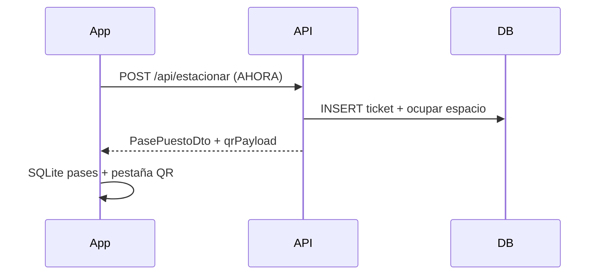
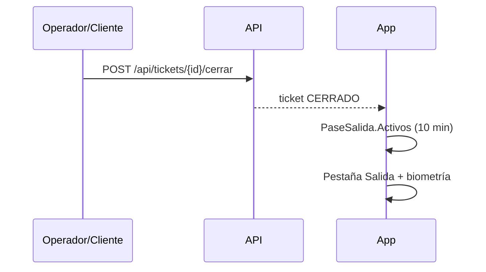
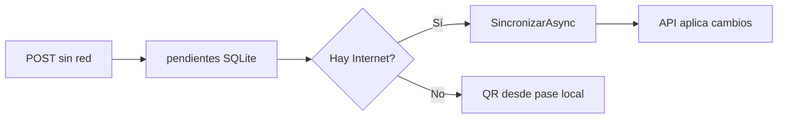
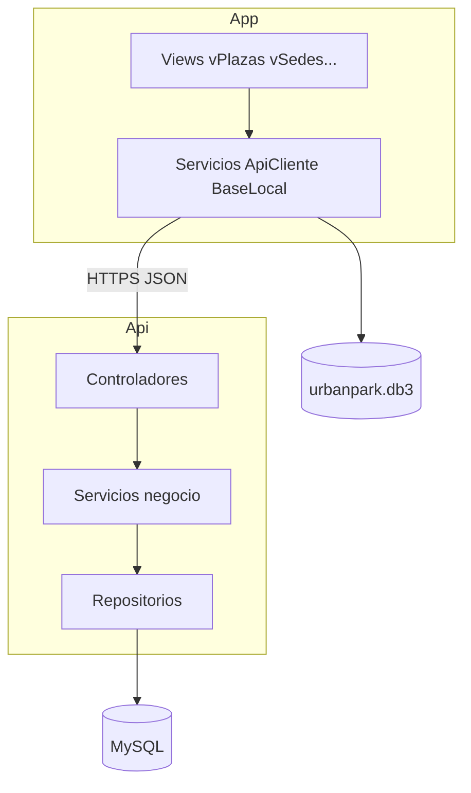

# Manual del programador — Urban Park

Documentación técnica del sistema **Urban Park** (versión móvil): aplicación **.NET MAUI**, API **ASP.NET Core**, base **MySQL**, IA **DeepSeek**, modo sin conexión con **SQLite**.

Repositorio: <https://github.com/mgbunay2015/UrbanPark>

---

## 1. Visión general

| Componente | Tecnología | Carpeta |
|-----------|------------|---------|
| Cliente móvil / escritorio | .NET MAUI (C#), .NET 10 | `UrbanPark.App/` |
| API REST | ASP.NET Core, .NET 10 | `UrbanPark.Api/` |
| Base de datos servidor | MySQL 8 (`urbanpark`) | `database/urbanpark_mysql.sql` |
| Base local (offline) | SQLite (`urbanpark.db3`) | En `BaseLocal.cs` |
| IA | API DeepSeek (`deepseek-chat`) + heurística local | `UrbanPark.Api/Servicios/` |
| Autenticación | JWT propio HS256 + TOTP + Google (opcional) | `AuthController`, `Sesion.cs` |

**Flujo funcional:** mapa de sedes → elección de parqueadero → plazas → ticket (`AHORA` o `RESERVA`) → **QR** con valor en tiempo real → pago y QR de salida.

---

## 2. Estructura del repositorio

```
Parqueadero/
├── UrbanPark.slnx              Solución
├── UrbanPark.App/              App MAUI
│   ├── Modelos/Modelos.cs      DTOs (espejo del API)
│   ├── Servicios/              Cliente HTTP, sesión, SQLite, mapas, ubicación
│   ├── Views/                  Pantallas (vSedes, vPlazas, vQrPuesto, …)
│   └── Platforms/              Android, Windows, iOS, MacCatalyst
├── UrbanPark.Api/
│   ├── Program.cs              JWT, Swagger, CORS, arranque MySQL
│   ├── Controladores/          REST por dominio
│   ├── Repositorios/           SQL parametrizado (sin ORM)
│   ├── Servicios/              Negocio, DeepSeek, resiliencia
│   ├── Modelos/                Entidades, DTOs, Reglas
│   └── Data/                   Db, InicializadorDb
├── database/                   Scripts MySQL
├── docs/                       Arquitectura, guías, este manual
├── tests/                      Pruebas unitarias, integración, HTTP
└── tools/ExportarManual/       Genera PDF de este manual
```

---

## 3. Configuración y arranque

### 3.1 MySQL

| Parámetro | Desarrollo (proyecto) |
|-----------|----------------------|
| Host | `localhost` |
| Puerto | `3306` |
| Base | `urbanpark` |
| Usuario | `root` |
| Contraseña | `urban123` (cambiar en producción) |

La API puede crear esquema y semilla al arrancar (`InicializadorDb.cs`) o usar `database/urbanpark_mysql.sql`.

Docker:

```bash
docker run -d --name urbanpark-mysql \
  -e MYSQL_ROOT_PASSWORD=urban123 \
  -e MYSQL_DATABASE=urbanpark \
  -p 3306:3306 mysql:8.4
```

### 3.2 API (`UrbanPark.Api/appsettings.json`)

| Clave | Uso |
|-------|-----|
| `ConnectionStrings:UrbanPark` | Cadena MySQL |
| `Jwt:Key` | Clave HS256 (≥ 32 caracteres) |
| `DeepSeek:ApiKey` | Opcional; sin clave → heurística |
| `Google:ClientId` | Opcional; login Google |
| `Urls` | Por defecto `http://0.0.0.0:8090` |

```bash
cd UrbanPark.Api
dotnet run
# Swagger: http://localhost:8090/swagger
```

### 3.3 App MAUI

```bash
# Windows (rápido)
dotnet build UrbanPark.App -f net10.0-windows10.0.19041.0 -t:Run

# Android (emulador encendido)
dotnet build UrbanPark.App -f net10.0-android -t:Run
```

URL del API en la app: **Perfil → Conexión con el API** (o `ApiCliente.cs` por defecto `http://127.0.0.1:8090`).

---

## 4. Arquitectura lógica

```
Login / TOTP / Google
        │  JWT
        ▼
   UrbanPark.App  ──HTTP JSON──►  UrbanPark.Api  ──►  MySQL
        │                              │
        │ SQLite (offline)             └──► DeepSeek API
        └── urbanpark.db3
```

### Capas del API

| Capa | Responsabilidad |
|------|-----------------|
| `Controladores/` | Rutas HTTP, `[Authorize(Roles)]`, códigos de error |
| `Repositorios/` | Consultas SQL |
| `Servicios/` | Tickets, pases QR, IA, JWT, Google, circuit breaker |
| `Modelos/Reglas.cs` | Cobro, placas, validaciones compartidas |
| `Data/` | Conexión y migraciones ligeras |

### Equivalencia con el sistema original Java

Microservicios Spring + Keycloak + PostgreSQL + Ollama se unifican en **un solo API** y **JWT propio**. Rutas y reglas de negocio se mantienen. Detalle en `docs/ARQUITECTURA.md`.

---

## 5. API REST (detalle)

Prefijos de controlador en `UrbanPark.Api/Controladores/`. Roles: **P** = público, **A** = autenticado,
**C/O/D** = CLIENTE / OPERADOR / ADMIN.

### 5.1 Autenticación — `AuthController` → `/api/auth`

| Método | Ruta | Rol | Notas |
|--------|------|-----|-------|
| POST | `/register` | P | Alta pública; roles permitidos en body |
| POST | `/login` | P | `accessToken`, `refreshToken`; puede devolver `TOTP_REQUIRED` |
| POST | `/google` | P | Valida `id_token` de Google |
| POST | `/refresh` | P | Renueva JWT con refresh token |
| GET | `/google/config` | P | ¿Backend con Google configurado? |
| GET | `/salud` | P | Health check |
| GET | `/totp/estado` | A | Segundo factor activo |
| POST | `/totp/preparar` | A | Secreto + URI `otpauth://` |
| POST | `/totp/confirmar` | A | Activa TOTP con código |
| POST | `/totp/desactivar` | A | Desactiva con código válido |
| POST | `/biometria` | A | Registra huella del usuario en servidor |
| POST | `/login-codigo` | P | Login solo con código TOTP (equipo vinculado) |
| POST | `/login-dispositivo` | P | Vincula equipo tras TOTP |
| GET | `/totp/requerido` | P | Política de segundo factor |

### 5.2 Perfil — `PerfilController` → `/api/perfil`

| Método | Ruta | Rol |
|--------|------|-----|
| GET | `/me` | A |
| PUT | `/me` | A |
| PUT | `/me/password` | A |

### 5.3 Usuarios admin — `AdminUsuariosController` → `/api/admin/users`

| Método | Ruta | Rol |
|--------|------|-----|
| GET | `/` y `/{id}` | D |
| POST | `/` | D |
| PUT | `/{id}` | D |
| PUT | `/{id}/roles` | D | ADMIN implica también OPERADOR |
| PUT | `/{id}/password` | D |
| PUT | `/{id}/totp` | D | Reset TOTP (borra equipos vinculados) |

### 5.4 Tarifas admin — `AdminTarifasController` → `/api/admin/tarifas`

| Método | Ruta | Rol |
|--------|------|-----|
| GET | `/resumen` | D |
| POST | `/aplicar` | D | Cambio masivo por sede/zona |

### 5.5 Sedes — `SedesController` → `/api/sedes`

| Método | Ruta | Rol |
|--------|------|-----|
| GET | `?lat=&lng=&tipo=&preferencia=` | A | 12 sedes + distancia + ocupación |
| GET | `/{id}?lat=&lng=` | A | Detalle y zonas |
| POST | `/recomendar` | C, D | IA + explicación |

### 5.6 Espacios — `EspaciosController` → `/api/espacios`

| Método | Ruta | Rol |
|--------|------|-----|
| GET | `?sedeId=` | A |
| GET | `/disponibles?tipo=&zona=&sedeId=` | A |
| GET | `/ocupacion?sedeId=` | A |
| GET | `/{id}` | A |
| POST | `/` | O, D |
| PUT | `/{id}` | O, D | No cambia `ocupado` |
| POST | `/{id}/ocupar` | C, O, D |
| POST | `/{id}/liberar` | C, O, D |

### 5.7 Estacionar / QR — `EstacionarController` → `/api/estacionar`

| Método | Ruta | Rol | Cuerpo / respuesta |
|--------|------|-----|---------------------|
| POST | `/` | C,O,D | `placa`, `espacioId`, `modo`, fechas si RESERVA → `PasePuestoDto` |
| GET | `/{ticketId}` | C,O,D | Refresco de monto y `qrPayload` |
| POST | `/{ticketId}/activar` | C,O,D | Reserva → ABIERTO |
| POST | `/{ticketId}/cancelar` | C,O,D | ANULADO, libera plaza |

### 5.8 Vehículos — `VehiculosController` → `/api/vehiculos`

| Método | Ruta | Rol |
|--------|------|-----|
| GET | `/` | C,O,D | Cliente: solo suyos |
| GET | `/{id}`, `/placa/{placa}` | C,O,D |
| GET | `/consultar/{placa}` | C,O,D | Datos externos demo |
| GET | `/consultar/{placa}/matricula` | C,O,D |
| POST | `/` | C,O,D |
| PUT | `/{id}` | O,D | Placa inmutable |
| PATCH | `/{id}/activo` | O,D |
| DELETE | `/{id}` | O,D | 200 vacío (como el original) |

### 5.9 Tickets — `TicketsController` → `/api/tickets`

| Método | Ruta | Rol |
|--------|------|-----|
| GET | `/`, `/abiertos`, `/{id}` | C,O,D |
| POST | `/abrir` | C,O,D |
| POST | `/{id}/cerrar` | C,O,D | Cobro; puede dejar `liberacion_pendiente` |
| GET | `/ocupacion` | D | Circuit breaker + fallback 200 |
| GET | `/resilience/estado` | D |
| GET/POST | `/demo/espacios/*` | D | Simular caída de espacios |
| POST | `/reconciliar-plazas` | D |
| POST | `/sincronizar-liberaciones` | O,D |

### 5.10 Biometrías — `BiometriasController` → `/api/biometrias`

| Método | Ruta | Rol |
|--------|------|-----|
| GET | `/` | A | ¿Tiene huella en BD? |
| POST | `/` | A | Alta |
| POST | `/verificar` | A | Comprueba plantilla |

### 5.11 IA — `IaController` → `/api/ia`

| Método | Ruta | Rol |
|--------|------|-----|
| POST | `/recomendar` | C,D | OPERADOR → 403 |
| POST | `/asignar` | C,D |
| POST | `/reporte-tickets` | D |
| POST | `/chat` | A |
| GET | `/estado`, `/ollama` | A |
| GET | `/salud` | P |

### 5.12 Contrato JSON y errores

- Serialización: **camelCase** (configurado en API y en `JsonUrbanPark` en la app).
- Errores: cuerpo `ErrorApi` con `mensaje` / `error` (p. ej. `TOTP_REQUIRED`, validación de placa).
- Swagger: `http://localhost:8090/swagger` — pegar JWT en **Authorize**.

---

## 6. Base de datos MySQL

Inicialización: `Data/InicializadorDb.cs` (crea BD, tablas, índices, migración `usuario_id`, semilla).
Conexión: `Data/Db.cs` (MySQLConnector, consultas async).

### 6.1 Tablas

| Tabla | Responsabilidad | Campos notables |
|-------|-----------------|-----------------|
| `usuarios` | Login, roles, TOTP | `password_hash` PBKDF2, `totp_secret`, `google_sub`, `roles` CSV |
| `sedes` | 12 parqueaderos | `codigo` (CEN…EBA), coords, `tarifa_base`, flags servicios |
| `espacios` | 768 plazas | `codigo` único `Sede-Zona-N`, `ocupado`, `nivel` (sótano negativo) |
| `vehiculos` | Flota | `placa` única, `propietario_usuario_id`, `descuento` % |
| `tickets` | Estancias | `estado`, `modo`, `liberacion_pendiente`, `salida_prevista` |
| `biometrias` | Huella en servidor | `usuario_id`, plantilla |
| `dispositivos` | Equipos vinculados TOTP | Token de dispositivo para login rápido |

### 6.2 Índices

`estado`, `placa`, `espacio_id`, `usuario`, `usuario_id`, `liberacion_pendiente`, `sede_id` en `tickets`
y tablas relacionadas (mejoran listados y cobro).

### 6.3 Regla «solo lo mío»

- Claim JWT `usuario_id` → filtro en repositorios.
- Migración: tickets/vehículos antiguos rellenan `usuario_id` cruzando `username`.

### 6.4 Convención de códigos de plaza

`{Sede}-{Zona}-{Número}` — ejemplo `MAR-C-07`. Zona en texto: `"Isla Central - Lindero Este"`.

### 6.5 Semilla y tarifas

768 plazas; tarifas por plaza entre **$0.50 – $0.90**/h según sede/tipo. Script completo:
`database/urbanpark_mysql.sql`.

---

## 7. Reglas de negocio (código)

Definidas en `UrbanPark.Api/Modelos/Reglas.cs` y replicadas en la app (`Ui`, `vQrPuesto`):

**Cobro**

```
minutos = max(1, floor(segundos/60))
horas   = ceil(minutos / 60)
monto   = round(horas * tarifa_hora, 2)
```

- Mínimo 1 hora facturable.
- Un ticket **ABIERTO** por placa y por plaza.
- Cerrar ticket con espacios caídos: cobra igual, `liberacion_pendiente = true`.

**Placa:** normalización mayúsculas; regex `^[A-Z0-9]{2,8}(-?[A-Z0-9]{1,4})?$`.

**Modos**

| Modo | Comportamiento |
|------|----------------|
| `AHORA` | Ticket ABIERTO al instante |
| `RESERVA` | RESERVADO con franja; estimado en QR; activar al llegar |

---

## 8. Cliente MAUI

### 8.1 Navegación (`Views/vPrincipal.cs`)

`Shell` con `TabBar` dinámico:

| Pestaña | Contenido |
|---------|-----------|
| **Mapa** | `vSedes` (sin puesto) o `vPlazas(sede)` (con puesto/reserva) |
| **Autos** | `vVehiculos` |
| **Llegar** | `vLlegada` (rutas / mapa Leaflet) |
| **QR** | `vQrPuesto` (solo si hay ticket activo) |
| **Tickets** / **Reportería** | Operador / Admin |
| **Perfil** / **Salir** | Siempre |

`AjustarPestanasAsync()` consulta `PuestoActual` y recompone Mapa + QR sin dejar el Shell sin página.

### 8.2 Pantallas principales

| Vista | Archivo | Función |
|-------|---------|---------|
| Login | `vLogin.xaml.cs` | Usuario, TOTP, huella, offline |
| Sedes | `vSedes.xaml.cs` | Mapa 12 sedes, tarjeta «mi puesto» |
| Plazas | `vPlazas.xaml.cs` | Plano del parqueadero, señalética, reserva |
| QR puesto | `vQrPuesto.xaml.cs` | QR, monto en vivo, pagar / llegar |
| Llegada | `vLlegada.xaml.cs` | Lista + mapa hacia sede |
| Tickets | `vTickets.xaml.cs` | Cobro, múltiples QR salida |
| Salida | `vSalida.xaml.cs` | QR post-pago (10 min) |
| IA | `vIa.xaml.cs` | Asignación y chat |
| Reporte | `vReporte.xaml.cs` | Métricas + PDF QuestPDF |

### 8.3 Servicios clave (`UrbanPark.App/Servicios/`)

| Archivo | Responsabilidad |
|---------|-----------------|
| `ApiCliente.cs` | `Get/Post/Put/Delete`, `RefrescarAsync`, cola `pendientes`, `SincronizarAsync` |
| `Sesion.cs` | JWT, roles, `usuario_id`, `SecureStorage` |
| `BaseLocal.cs` | SQLite + candado global; tablas en `BaseLocal.Tablas.cs` |
| `AlmacenLocal.cs` | `Reflejar` respuestas GET; encolar escrituras sin red |
| `PuestoActual.cs` | Carga pase vigente + sede para pestaña Mapa/QR |
| `PaseSalida.cs` | QRs de salida 10 min; evento `Cambio` para pestaña Salida |
| `MapaGoogle.cs` | HTML Leaflet (Esri + OSM), popups hover sede/usuario |
| `Ubicacion.cs` | GPS, geocodificación inversa, Quito por defecto |
| `BiometriaServicio.cs` | Registro/verificación huella; QR salida protegido |
| `CredencialLocal.cs` | Hash PBKDF2 para login offline |
| `Ui.cs` | Alertas, moneda EC, estilos XAML |
| `IndicadorConexion.cs` | Punto verde/rojo en ventana |
| `ReportePdf.cs` | Export QuestPDF (admin) |
| `Registro.cs` | Log diagnóstico cliente |

Ruta SQLite: `FileSystem.AppDataDirectory/urbanpark.db3` (`BaseLocal.Ruta`).

### 8.4 Todas las pantallas (`Views/`)

| Vista | Rol típico | Función principal |
|-------|------------|---------------------|
| `vLogin` / `vRegistro` | Público | Sesión, TOTP, huella, demo |
| `vPrincipal` (Shell) | — | TabBar dinámico (ver §8.5) |
| `vSedes` | Todos | Mapa WebView 12 sedes; tarjeta «mi puesto» |
| `vPlazas` | Todos | Plano SVG de bahías, reserva, IA por sede |
| `vLlegada` | Cliente | Rutas a pie, filtros sector |
| `vQrPuesto` | Todos | QR entrada/reserva, monto vivo |
| `vReserva` | Todos | Franja horaria antes de confirmar |
| `vVehiculos` | Todos | CRUD vehículos (cliente: solo suyos) |
| `vTickets` | Todos | Abrir/cerrar; admin cobra en caja |
| `vSalida` | Cliente | QR salida post-pago |
| `vIa` | C, Admin | Recomendar, asignar, chat |
| `vReporte` / `vTarifas` | Admin | Métricas, PDF, tarifas masivas |
| `vResilience` | Admin | Demo circuit breaker |
| `vUsuarios` | Admin | ABM usuarios |
| `vPerfil` / `vTotp` | Todos | Perfil, 2FA, URL API |
| `vToken` | Todos | Visualizar JWT |
| `vMenu` / `vHoy` / `vMas` | Legado / auxiliar | Menús anteriores |
| `TicketDigital.cs` | — | Componente ticket + QR reutilizable |

### 8.5 Shell y pestañas (`vPrincipal.cs`)

| Pestaña | Contenido dinámico |
|---------|-------------------|
| Mapa | `vSedes()` sin puesto; `vPlazas(sede)` con puesto/reserva |
| Autos | `vVehiculos` |
| Llegar | `vLlegada` (cliente/operador) |
| QR | `vQrPuesto` si hay ticket activo |
| Tickets / Reportería | Operador y admin |
| Salida | `vSalida` si hay `PaseSalida.Activos` |
| Perfil / Salir | Fijos |

`AjustarPestanasAsync()` lee `PuestoActual`; `SuspenderReajuste()` durante cobro (evita crash Shell).
`IrAPestana("QR"|"Llegar"|"Salida")` para navegación desde botones. QR/Llegar no apilan mapas sobre QR.

### 8.6 Plano de plazas (`vPlazas.xaml.cs`) — referencia UI

| Elemento | Descripción |
|----------|-------------|
| `BahiaPlano()` | Bahía con borde amarillo = mi puesto / elegido |
| `FlechaPiso()` / cebras | Señalética piso, doble vía ▲▼ |
| `_soloPlano` | Oculta filtros; botón «Ver Detalle» / «Solo plano» |
| `capaUbicacionBahia` | Popup hover en puesto amarillo (ubicación) |
| `capaLeyenda` | Significado de símbolos |
| `Toque()` | Misma lógica que tarjeta grande: reservar, ticket, IA |

### 8.7 Payload del QR (`PasePuestoDto`)

Campos críticos: `QrPayload` (string escaneable), `MontoAhora`, `MinutosTranscurridos`,
`HorasCobradas`, datos sede/plaza/placa. Generación imagen: `QRCoder` en `vQrPuesto` y `TicketDigital`.
Formato fallback local: `URBANPARK|ESTACION|{codigo}|…` si el servidor no envía payload.

### 8.8 Flujo QR (secuencia)

1. Usuario toca plaza libre → diálogo **Entrar ahora** / **Reservar**.
2. `POST /api/estacionar` → `PasePuestoDto`.
3. `AlmacenLocal` persiste JSON en tabla `pases`.
4. `vPrincipal.RevisarPestanas()` añade pestaña QR.
5. Timer 1 s en `vQrPuesto` recalcula monto (y opcional `GET /estacionar/{id}` si hay red).
6. Cierre: `POST /api/tickets/{id}/cerrar` → `PaseSalida` → pestaña Salida (QR 10 min).

---

## 9. Modo sin conexión

### 9.1 Tablas SQLite (`BaseLocal.Tablas.cs`)

| Tabla | Contenido |
|-------|-----------|
| `ajustes` | Clave/valor (marcas sync) |
| `pases` | JSON `PasePuestoDto` por `ticket_id` |
| `vehiculos` | JSON `VehiculoDto` por placa |
| `sedes` / `espacios` | JSON cache por sede |
| `tickets` | Tickets abiertos del usuario |
| `pendientes` | Cola POST/PUT/DELETE sin red |

Todas las filas de usuario llevan `usuario_id` para no mezclar cuentas en un mismo equipo.

### 9.2 Pipeline `ApiCliente.EnviarAsync`

1. Si hay JWT y expira pronto → `RefrescarAsync()`.
2. HTTP con timeout y cabecera `Authorization: Bearer …`.
3. Si OK → `AlmacenLocal.Reflejar` (GET) o `ReflejarEscritura`.
4. Si sin red en escritura → insert en `pendientes` y respuesta optimista local.
5. `Connectivity.ConnectivityChanged` en `App.xaml.cs` dispara `SincronizarAsync`.
6. `RecuperarSesionAsync`: refresh token o login dispositivo sin pedir contraseña.

### 9.3 Sincronización al reconectar

- Reintentos 5xx; descarta 4xx para no bloquear cola.
- Aviso toast si había cambios pendientes (`OnCambioConectividad`).

Prueba automatizada: `dotnet run --project tests/SyncLocal/SyncLocal.csproj`

---

## 10. Seguridad

- Contraseñas: **PBKDF2-SHA256**, 100 000 iteraciones.
- JWT: claims `preferred_username`, `usuario_id`, `role`, `realm_access.roles`.
- Acceso: 300 s; refresh 7 días; renovación automática en app (&lt; 15 s).
- TOTP RFC 6238 en `usuarios.totp_secret`.
- QR de salida: biometría opcional (`BiometriaServicio`).

---

## 11. Resiliencia (demo admin)

`ResilienciaService` en `GET /api/tickets/ocupacion`:

- Ventana 10, umbral 50 %, open 10 s, retry ×3 backoff.
- Fallback **200** con `fallback: true`.
- Flag `Demo:EspaciosCaido` simula caída de espacios.

---

## 12. Pruebas automáticas

| Proyecto | Qué valida |
|----------|------------|
| `tests/UrbanPark.Pruebas` | Reglas sin MySQL |
| `tests/UrbanPark.Integracion` | SQL + repositorios |
| `tests/prueba_http.ps1` | Recorrido HTTP completo |

```bash
dotnet run --project tests/UrbanPark.Pruebas
dotnet run --project tests/UrbanPark.Integracion
```

---

## 13. Usuarios demo

| Usuario | Contraseña | Rol |
|---------|------------|-----|
| cliente1 | cliente123 | CLIENTE |
| cliente2 | cliente123 | CLIENTE |
| cliente3 | cliente123 | CLIENTE |
| operador1 | operador123 | OPERADOR |
| admin1 | admin123 | ADMIN + OPERADOR |

Jerarquía efectiva: **ADMIN > OPERADOR > CLIENTE**.

---

## 14. Generar este manual en PDF

```powershell
dotnet run --project tools/ExportarManual/ExportarManual.csproj
```

Salida: `docs/MANUAL_PROGRAMADOR.pdf`

También: `powershell -ExecutionPolicy Bypass -File docs/generar-manual-pdf.ps1`

---

## 15. Backend — mapa de servicios y repositorios

### 15.1 Servicios (`UrbanPark.Api/Servicios/`)

| Servicio | Uso |
|----------|-----|
| `ServicioEstacionamiento` | Abrir pase, activar/cancelar reserva, armar QR |
| `ServicioTickets` | Abrir/cerrar, cobro, liberaciones pendientes |
| `ServicioEspacios` | Ocupar/liberar con `UPDATE … WHERE ocupado=0` (anti carrera) |
| `ServicioSedes` | Listado, distancias, recomendación |
| `ServicioTarifasAdmin` | Resumen y aplicación masiva |
| `DeepSeekService` | Chat, asignar plaza, reporte narrativo |
| `ResilienciaService` | Circuit breaker ocupación |
| `TokenService` / `PasswordService` | JWT y PBKDF2 |
| `GoogleAuthService` / `ServicioTotp` | OAuth y RFC 6238 |
| `ConsultaVehiculoService` | Datos demo matrícula |
| `EstadoDemoService` | Flag «espacios caídos» |

### 15.2 Repositorios (`UrbanPark.Api/Repositorios/`)

| Repositorio | Entidad |
|-------------|---------|
| `UsuarioRepositorio` | `usuarios` |
| `SedeRepositorio` | `sedes` |
| `EspacioRepositorio` | `espacios` |
| `VehiculoRepositorio` | `vehiculos` |
| `TicketRepositorio` | `tickets` |
| `BiometriaRepositorio` | `biometrias` |
| `DispositivoRepositorio` | `dispositivos` |
| `ReporteBalanceRepositorio` | agregados reportería |

### 15.3 DTOs principales (app = API)

Definidos en `UrbanPark.App/Modelos/Modelos.cs` y espejo en API `Modelos/Dtos.cs`:

`SesionDto`, `SedeDto`, `EspacioDto`, `PasePuestoDto`, `TicketDto`, `VehiculoDto`,
`ReporteDto`, `RecomendacionDto`, `AsignacionDto`, `ChatRespuestaDto`, `ErrorApi`.

---

## 16. Configuración completa (`appsettings.json`)

| Sección | Claves | Efecto |
|---------|--------|--------|
| `ConnectionStrings` | `UrbanPark` | MySQL |
| `Urls` | `http://0.0.0.0:8090` | Escucha API |
| `Jwt` | `Key`, `Issuer`, `Audience`, minutos/días | Tokens |
| `DeepSeek` | `ApiKey`, `BaseUrl`, `Model`, `TimeoutSeconds` | IA |
| `Google` | `ClientId`, `AndroidClientId` | Login social |
| `Demo` | `EspaciosCaido` | Resiliencia demo |
| CORS | en `Program.cs` | Origenes MAUI |

Archivo local opcional (no versionado): `appsettings.Local.json`.

### URLs por plataforma (app)

| Plataforma | URL API típica |
|------------|----------------|
| Windows | `http://127.0.0.1:8090` o `localhost` |
| Emulador Android | `http://10.0.2.2:8090` |
| Celular WiFi | `http://{IP_PC}:8090` |

---

## 17. Flujos de negocio (diagramas)

### 17.1 Estacionar ahora



### 17.2 Cobro y salida



### 17.3 Offline



---

## 18. Pestañas por rol (app)

| Rol | Pestañas visibles (aprox.) |
|-----|---------------------------|
| CLIENTE | Mapa, Autos, Llegar, QR*, Perfil, Salir, Salida* |
| OPERADOR | Mapa, Autos, Tickets, Llegar, Perfil, Salir |
| ADMIN | Mapa, Autos, Tickets, Reportería, Perfil, Salir (+ Resilience vía menú admin) |

\* QR y Salida solo cuando aplica puesto/pago.

Jerarquía: un usuario con `ADMIN,OPERADOR` se trata como **ADMIN** en UI.

---

## 19. Pruebas y calidad

| Proyecto | Comando | Qué cubre |
|----------|---------|-----------|
| `UrbanPark.Pruebas` | `dotnet run --project tests/UrbanPark.Pruebas` | Reglas, placas, TOTP vectores |
| `UrbanPark.Integracion` | Requiere MySQL | Repos + SQL |
| `prueba_http.ps1` | API en marcha | 86 pasos HTTP |
| `SyncLocal` | Cola offline | 7 tablas SQLite |

Estado documentado en README: **281** comprobaciones combinadas.

---

## 20. Problemas frecuentes (desarrollo)

| Síntoma | Causa / solución |
|---------|------------------|
| MSB3021 al compilar app | Cerrar `UrbanPark.App.exe` |
| Pantalla Shell en blanco | Pestaña Mapa recreada; revisar `vPrincipal.RestaurarPestana` |
| QR muestra mapa | Navegación apilada; usar pestaña Llegar, no Push desde QR |
| `TOTP_REQUIRED` | Enviar código 6 dígitos en login |
| `heuristica-local` | Sin DeepSeek; configurar `DeepSeek:ApiKey` |
| Fallback ocupación | Demo «espacios caídos» activa; `POST demo/espacios/start` |
| Google 503 | `ClientId` placeholder; configurar consola Google |
| Emulador no conecta API | Usar `10.0.2.2`, firewall 8090 |

---

## 21. Seguridad operativa

- No commitear `appsettings.Local.json`, `backups/`, ni logs con tokens.
- Cambiar `Jwt:Key` y password MySQL en producción.
- `admin1` tiene poder sobre TOTP ajeno (`PUT …/totp`).
- QR de salida: ventana **10 minutos**; puede exigir huella (`BiometriaServicio`).

---

## 22. Referencias en el repositorio

| Documento | Contenido |
|-----------|-----------|
| `README.md` | Guía general y capturas |
| `docs/ARQUITECTURA.md` | Endpoints completos, esquema, IA |
| `docs/GUIA_EJECUCION.md` | Instalación paso a paso |
| `docs/DISENO_UI.md` | Paleta y componentes |
| `docs/Referencia_Original_*.md` | Contrato del sistema Java |

---

## 23. Inventario de archivos — UrbanPark.Api

Cada archivo C# del backend y para qué sirve. Rutas relativas a `UrbanPark.Api/`.

### 23.1 Arranque y datos

| Archivo | Explicación |
|---------|-------------|
| `Program.cs` | Punto de entrada: valida `Jwt:Key`, registra JWT Bearer, Swagger, CORS, DI de repositorios/servicios, middleware de errores, `InicializadorDb` al arrancar y escucha en `Urls`. |
| `Data/Db.cs` | Singleton de conexión MySQL (MySqlConnector). Expone métodos de consulta ejecutados por los repositorios. |
| `Data/InicializadorDb.cs` | Crea BD `urbanpark`, tablas, índices, migración `usuario_id`, datos semilla (12 sedes, 768 espacios, usuarios demo). Idempotente en cada arranque. |
| `appsettings.json` | Configuración: MySQL, JWT, DeepSeek, Google, demo resiliencia, URL puerto 8090. `appsettings.Local.json` opcional (no versionado). |

### 23.2 Modelos

| Archivo | Explicación |
|---------|-------------|
| `Modelos/Entidades.cs` | Clases de fila MySQL: `Usuario`, `Sede`, `Espacio`, `Vehiculo`, `Biometria`, `Ticket`, `Dispositivo`, etc. |
| `Modelos/Dtos.cs` | Contratos JSON de entrada/salida (espejo de `UrbanPark.App/Modelos/Modelos.cs`). |
| `Modelos/Reglas.cs` | Lógica pura compartida: cobro por horas, validación de placa, normalización, comprobaciones de ticket único. |

### 23.3 Controladores (`Controladores/`)

| Archivo | Ruta base | Explicación |
|---------|-----------|-------------|
| `ControladorBase.cs` | — | Extrae `usuario_id`, username y rol del JWT; helpers `Error400/403/404` con formato del frontend original. |
| `AuthController.cs` | `/api/auth` | Registro, login, refresh, Google, TOTP, biometría en servidor, login por código/dispositivo vinculado. |
| `PerfilController.cs` | `/api/perfil` | Lee y actualiza datos del usuario autenticado; cambio de contraseña. |
| `AdminUsuariosController.cs` | `/api/admin/users` | CRUD usuarios, roles, reset contraseña y TOTP (solo ADMIN). |
| `AdminTarifasController.cs` | `/api/admin/tarifas` | Resumen de tarifas y aplicación masiva por sede/zona (ADMIN). |
| `SedesController.cs` | `/api/sedes` | Listado con distancia, detalle por id, POST recomendar (puntaje + texto IA). |
| `EspaciosController.cs` | `/api/espacios` | CRUD plazas, disponibles, ocupación, ocupar/liberar; respeta demo «espacios caídos». |
| `EstacionarController.cs` | `/api/estacionar` | Flujo principal del cliente: abre ticket, devuelve `PasePuestoDto` + QR; activar/cancelar reserva. |
| `VehiculosController.cs` | `/api/vehiculos` | CRUD vehículos; consulta placa externa demo; filtro por dueño si es CLIENTE. |
| `TicketsController.cs` | `/api/tickets` | Abrir/cerrar tickets, ocupación con circuit breaker, reconciliar, sincronizar liberaciones, demo stop/start espacios. |
| `BiometriasController.cs` | `/api/biometrias` | Alta y verificación de plantilla biométrica en MySQL. |
| `IaController.cs` | `/api/ia` | Recomendar sede/plaza, reporte narrativo, chat, estado del proveedor IA. |

### 23.4 Repositorios (`Repositorios/`)

| Archivo | Explicación |
|---------|-------------|
| `UsuarioRepositorio.cs` | SQL de usuarios: login, TOTP, roles, Google `sub`. |
| `SedeRepositorio.cs` | Lectura de sedes, agregados de ocupación, búsqueda por coordenadas. |
| `EspacioRepositorio.cs` | Listados por sede/zona/tipo; `UPDATE ocupado` con condición anti doble reserva. |
| `VehiculoRepositorio.cs` | Placas por usuario; altas y bajas lógicas. |
| `TicketRepositorio.cs` | Tickets abiertos/cerrados, códigos TK-, liberación pendiente. |
| `BiometriaRepositorio.cs` | Plantillas por `usuario_id`. |
| `DispositivoRepositorio.cs` | Equipos vinculados para login rápido con TOTP. |
| `ReporteBalanceRepositorio.cs` | Agregaciones para reportería (dinero, ocupación, período). |

### 23.5 Servicios (`Servicios/`)

| Archivo | Explicación |
|---------|-------------|
| `PasswordService.cs` | Hash y verificación PBKDF2 compatible con script SQL. |
| `TokenService.cs` | Genera JWT HS256 y refresh tokens; claims compatibles Keycloak. |
| `GoogleAuthService.cs` | Valida `id_token` de Google contra la API de Google. |
| `ServicioTotp.cs` | Genera secreto TOTP, valida ventana de códigos, activación/desactivación. |
| `ServicioEstacionamiento.cs` | Arma `PasePuestoDto` completo (montos, QR payload, datos sede). |
| `ServicioTickets.cs` | Abrir/cerrar con cobro; compartido por controladores e IA. |
| `ServicioEspacios.cs` | Fachada «ms-espacios»; lanza si demo caído. |
| `ServicioSedes.cs` | Ranking de sedes + texto explicativo (IA o plantilla). |
| `ServicioTarifasAdmin.cs` | Aplica cambios de tarifa en lote. |
| `ReglasTarifa.cs` | Límites y redondeos de tarifas por zona/tipo. |
| `DeepSeekService.cs` | Cliente HTTP a chat completions; JSON para asignación; fallback si falla. |
| `ConsultaVehiculoService.cs` | Opcional: consulta placa en API pública Ecuador. |
| `ResilienciaService.cs` | Circuit breaker + retry + fallback para ocupación. |
| `EstadoDemoService.cs` | Flag global «espacios caídos» para pantalla Resilience. |
| `RegistroArchivo.cs` | Logger a `logs/urbanpark-api-AAAA-MM-DD.log`. |

---

## 24. Inventario de archivos — UrbanPark.App

### 24.1 Raíz y arranque MAUI

| Archivo | Explicación |
|---------|-------------|
| `App.xaml` / `App.xaml.cs` | Application: ventana inicial `vLogin`, inicia `BaseLocal`, engancha sincronización al volver internet e indicador global. |
| `MauiProgram.cs` | `CreateMauiApp`: fuentes, `Registro.Instalar()`, `MonitorConexion`, `IndicadorConexion`. |
| `UrbanPark.App.csproj` | Targets Android/Windows/iOS; paquetes QRCoder, QuestPDF, sqlite-net, etc. |

### 24.2 Modelos

| Archivo | Explicación |
|---------|-------------|
| `Modelos/Modelos.cs` | Todos los DTOs del cliente (`PasePuestoDto`, `SedeDto`, `TicketDto`…), `ApiExcepcion`, `JsonUrbanPark` con opciones de serialización. |

### 24.3 Servicios (`Servicios/`)

| Archivo | Explicación |
|---------|-------------|
| `ApiCliente.cs` | Cliente HTTP central: Bearer, refresh, traducción errores, URL base por plataforma, cola offline, `SincronizarAsync`, métodos por endpoint del API. |
| `Sesion.cs` | Usuario logueado, roles, tokens en `SecureStorage`, helpers `EsAdmin/EsCliente`. |
| `BaseLocal.cs` | Apertura SQLite (`urbanpark.db3`), candado, migraciones de columnas, APIs de lectura/escritura genéricas. |
| `BaseLocal.Tablas.cs` | Clases sqlite-net: `pases`, `vehiculos`, `pendientes`, etc. |
| `AlmacenLocal.cs` | Deserializa respuestas GET a tablas; encola POST/PUT sin red; reconstruye DTOs. |
| `CredencialLocal.cs` | Hash de contraseña por cuenta para login offline. |
| `PuestoActual.cs` | Cache del pase activo del usuario (ticket abierto o reserva). |
| `PaseSalida.cs` | Estado de QRs de salida post-cobro (10 min); evento para pestaña Salida. |
| `Ubicacion.cs` | `Geolocation`, permisos, geocodificación inversa, fallback Quito. |
| `MapaGoogle.cs` | Genera HTML Leaflet/Esri para `WebView`; popups hover en sedes y pin del usuario. |
| `PlacaEcuador.cs` | Control visual de placa ecuatoriana (MAUI shapes) en fichas de vehículo. |
| `BiometriaServicio.cs` | Windows Hello / huella: registro, verificación antes de QR salida. |
| `GoogleAuthServicio.cs` | `WebAuthenticator` para obtener `id_token` y enviarlo al API. |
| `Ui.cs` | Alertas, confirmaciones, formato moneda EC, estilos `StaticResource`, navegación con marca. |
| `Registro.cs` | Log a archivo en el dispositivo; captura excepciones no controladas. |
| `MonitorConexion.cs` | Timer que prueba internet + ping a `/api/auth/salud`. |
| `IndicadorConexion.cs` | Inserta `BarraConexion` en la ventana activa. |
| `ReportePdf.cs` | QuestPDF: exporta reporte admin por sede. |
| `ExcelDecisiones.cs` | NPOI: Excel analítico para decisiones de tarifas/ocupación. |

### 24.4 Pantallas — código (`Views/*.xaml.cs`)

| Archivo `.xaml.cs` | Explicación |
|--------------------|-------------|
| `vPrincipal.cs` | Shell `TabBar` dinámico (Mapa/QR/Salida); no es XAML, es la raíz tras login. |
| `vLogin.xaml.cs` | Login, registro público, TOTP/huella/offline; perfiles demo; navegación a `vPrincipal`. |
| `vRegistro.xaml.cs` | Visor del archivo de log (`Registro.cs`); se abre desde Perfil (no es alta de usuario). |
| `vSedes.xaml.cs` | Mapa WebView 12 sedes, IA sede, tarjeta estacionado, botones QR/Llegar. |
| `vPlazas.xaml.cs` | Plano de bahías, zonas, reserva/entrar, vista solo plano, leyenda, hover ubicación. |
| `vLlegada.xaml.cs` | Mapa + lista sedes, filtros sector, ruta al destino. |
| `vQrPuesto.xaml.cs` | QR QRCoder, reloj de cobro, pagar, cómo llegar (pestaña), anular reserva. |
| `vReserva.xaml.cs` | Formulario fecha/hora salida antes de `POST /estacionar` modo RESERVA. |
| `vVehiculos.xaml.cs` | Formulario alta vehículo y placa activa para reservar. |
| `vRegistrados.xaml.cs` | Lista de vehículos del usuario. |
| `vTickets.xaml.cs` | Grid tickets, cobro individual/masivo, sincronizar plazas, ir a salida. |
| `vSalida.xaml.cs` | Muestra QR(s) de salida con `TicketDigital`; exige biometría si hay huella. |
| `vIa.xaml.cs` | Recomendar plaza, asignar, chat con historial. |
| `vReporte.xaml.cs` | Filtros fecha/sede, métricas, botón narrativa IA, export PDF/Excel. |
| `vTarifas.xaml.cs` | Admin: cambio masivo de tarifas. |
| `vUsuarios.xaml.cs` | Admin: tabla usuarios, roles, contraseña, TOTP. |
| `vResilience.xaml.cs` | Admin: stop/start espacios, probar circuit breaker, ver JSON fallback. |
| `vPerfil.xaml.cs` | Datos personales, contraseña, URL API, biometría, TOTP, datos SQLite locales. |
| `vTotp.xaml.cs` | Wizard activar Google Authenticator (QR otpauth). |
| `vToken.xaml.cs` | Depuración: muestra claims y JWT crudo. |
| `vSalir.cs` | Limpia sesión y vuelve a login (conserva SQLite si el usuario lo elige). |
| `vMenu.xaml.cs` | Menú alternativo por rol (legacy); botón flotante QR salida en algunos flujos. |
| `vHoy.xaml.cs` | Vista demo de agenda (maqueta, no flujo principal). |
| `vMas.xaml.cs` | Enlaces secundarios (p. ej. cómo llegar vía push). |
| `vRegistro.xaml.cs` | Visor del archivo de log de la app (diagnóstico). |
| `TicketDigital.cs` | Componente UI reutilizable: layout ticket + QR para entrada y salida. |
| `MapaSedes.cs` | Mapa vectorial MAUI Graphics (alternativa sin WebView; usado en contextos sin Leaflet). |
| `BarraConexion.cs` | Control visual verde/rojo de conectividad. |

### 24.5 Pantallas — XAML (`Views/*.xaml`)

Cada `.xaml` define layout, estilos y controles nombrados (`x:Name`) que el `.xaml.cs` manipula. Patrón MAUI estándar: recursos en `Resources/Styles/`.

| XAML | Rol principal del layout |
|------|---------------------------|
| `vPlazas.xaml` | Panel controles + `marcoPlano` + scroll plazas + overlays leyenda/ubicación. |
| `vSedes.xaml` | WebView mapa, chips filtro, lista sedes, botones IA/refrescar. |
| `vQrPuesto.xaml` | Tarjeta ticket blanca, imagen QR, botones llegar/pagar/anular. |
| `vLogin.xaml` | Formulario login, TOTP, huella, cuentas demo. |
| `vTickets.xaml` | Lista tickets, filtros placa/estado, totales cobro. |
| Resto (`vPerfil`, `vReporte`, …) | Formularios y listas acordes a cada módulo admin/cliente. |

### 24.6 Recursos y plataformas

| Ruta | Explicación |
|------|-------------|
| `Resources/Styles/Colors.xaml` | Paleta Urban Park (fondo oscuro, acento amarillo `#F2C51A`). |
| `Resources/Styles/Styles.xaml` | Estilos globales botones, labels, entradas. |
| `Resources/Fonts/` | OpenSans Regular/Semibold. |
| `Resources/Images/` | Iconos tab bar, ilustraciones plaza (auto/moto/discapacidad). |
| `Platforms/Windows/` | `Package.appxmanifest` permisos ubicación; entrada WinUI. |
| `Platforms/Android/` | `MainActivity`, `CallbackActivity` (Google redirect), permisos manifest. |
| `Platforms/iOS/`, `MacCatalyst/` | Bootstraps MAUI en Apple (compilación opcional sin Mac limitada). |

---

## 25. Base de datos, pruebas y herramientas

### 25.1 `database/`

| Archivo | Explicación |
|---------|-------------|
| `urbanpark_mysql.sql` | Script idempotente completo: DROP/CREATE, semilla, usuarios demo con hash PBKDF2. |
| `urbanpark_actual.sql` | Variante o migración puntual del esquema (revisar cabecera del archivo antes de ejecutar). |

### 25.2 `tests/`

| Proyecto / script | Explicación |
|-------------------|-------------|
| `UrbanPark.Pruebas` | Unit tests de reglas (cobro, placa, TOTP) sin red. |
| `UrbanPark.Integracion` | Pruebas contra MySQL real (repositorios, SQL). |
| `prueba_http.ps1` | Batería REST contra API levantada (login, roles, tickets). |
| `SyncLocal` | Ciclo SQLite: tablas, encolado, sincronización. |
| `CobroSinRed`, `PagoLocal`, `TicketSalida`, etc. | Escenarios focalizados offline/cobro/salida. |
| `PestanasAdmin` | Comprueba límite de pestañas Shell en admin (evitar layout crash). |

### 25.3 `tools/ExportarManual/`

| Archivo | Explicación |
|---------|-------------|
| `Program.cs` | Lee `docs/MANUAL_PROGRAMADOR.md`, convierte con Markdig a HTML, imprime PDF con Edge. |
| `ExportarManual.csproj` | Consola .NET 10 + paquete Markdig. |
| `docs/generar-manual-pdf.ps1` | Atajo PowerShell con fallback Edge. |

### 25.4 Documentación (`docs/`)

| Archivo | Contenido |
|---------|-----------|
| `ARQUITECTURA.md` | Equivalencia Java, endpoints largos, resiliencia, DeepSeek. |
| `GUIA_EJECUCION.md` | Instalación, emulador, celular, problemas frecuentes. |
| `DISENO_UI.md` | Guía visual y componentes. |
| `CUSTOMER_JOURNEY_MAP.md` | Viaje del usuario (producto). |
| `Referencia_Original_*.md` | Contrato detallado del sistema HTML/Java. |
| `MANUAL_PROGRAMADOR.md` | Este manual (fuente del PDF). |
| `manual-pdf.css` | Hoja de estilos para impresión PDF. |

---

## 26. Diagrama de dependencias (lectura rápida)



**Regla práctica:** si cambias un endpoint, toca en cadena `Dtos.cs` (API) → `Modelos.cs` (app) → `ApiCliente` método → vista que lo llama.

---

## 27. Buenas prácticas para contribuir

1. Compilar con framework explícito (`-f net10.0-windows10.0.19041.0` o Android).
2. No commitear `appsettings.Local.json`, `backups/` ni logs.
3. Tras cambiar contratos, actualizar `Dtos.cs` (API), `Modelos.cs` (app) y el método en `ApiCliente`.
4. Añadir o actualizar la fila correspondiente en **§23–§25** de este manual si creas archivos nuevos.
5. Probar cobro y QR offline antes de release (`SyncLocal`, `CobroSinRed`).
6. Cerrar `UrbanPark.App.exe` antes de rebuild en Windows (evita MSB3021).